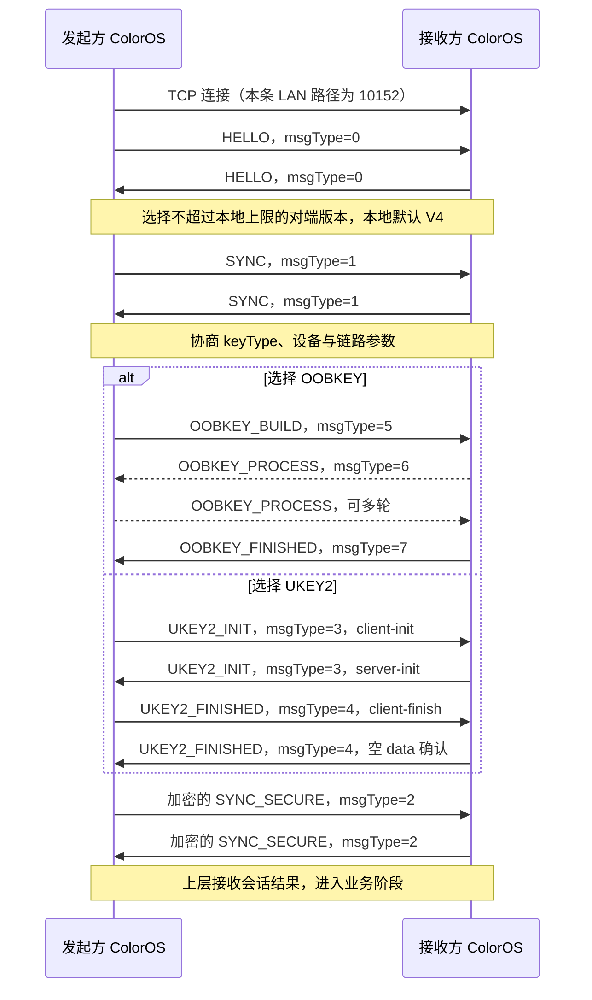

# ColorOS ↔ ColorOS 通信协议：Pantaconnect / SCP

目标是 ColorOS 设备之间的设备互联，不是 ColorOS 与 HyperOS 的适配。本说明基于一加 Ace 6 的 ColorOS 17 样本：`com.oplus.linker 17.7.30` 和 `com.heytap.accessory 17.6.16`。重点是实际设备间的发现、连接、会话和报文，Binder 仅用于解释系统组件分工。

**目前还原到的是一组实际实现的协议与分支，不是“所有 ColorOS 功能共用一个协议”。** 主链可概括为：

```text
BLE / LAN 发现
    ↓
Pantaconnect 建立物理连接（以下重点分析 LAN TCP）
    ↓
SCP HELLO → SYNC → 密钥协商 → SYNC_SECURE
    ↓
SCP BUSINESS 数据，或具体业务的 OAF/ICDF 等通道
```

同账号 LAN 主动连接默认选 **OOBKEY**；非同账号状态默认选 **UKEY2**，后续还会协商 keyType。OShare 文件分享另有独立的发现、认证与文件链，不能替换上述 SCP 会话。此结论来自分支条件和发送/解析代码，不是根据协议名猜测。

尚未用第二台 ColorOS 设备抓取真实会话，因此本文将“静态已证实”与“需要实机验证”分开。已分析的手机/平板/其他对端共享库也有角色条件，不能承诺每种 ColorOS 设备组合都启用相同业务。

## 证据与样本

沿用[样本与总体证据报告](protocol-analysis.md)中的 APK 哈希和工具记录。新增专项证据在：

- [20 项专项证据摘录](../../captures/device-interconnect-20261108/coloros17/analysis/coloros-to-coloros/evidence-excerpts.md)
- [专项证据哈希索引](../../captures/device-interconnect-20261108/coloros17/analysis/coloros-to-coloros/evidence-index.json)
- [重建的 Protobuf 字段定义](../../captures/device-interconnect-20261108/coloros17/analysis/coloros-to-coloros/scp-reconstructed.proto)

`A/` 表示 `captures/device-interconnect-20261108/coloros17/analysis/jadx/accessory/sources/`；`S/` 表示同 analysis 下的 `coloros-to-coloros/simple/`。C01–C20 是专项证据；E 编号见总体报告证据目录。行号是固定反编译产物的行号，原始 DEX 指令另存于 `analysis/dalvik/accessory/`。线性反编译用于绕过协程结构还原失败，关键枚举和调用顺序另与 DEX 核对。

## 1. 发现：已经确认什么

| 阶段 | 已证实内容 | 代码依据 |
| --- | --- | --- |
| BLE | Pantaconnect 实际读取多个 UUID 的 serviceData；需要按设备/模式区分 | E16、E17：A/.../discovery/bleprovider/advertise/b.java 和 scan/c.java |
| LAN 组播 | `239.255.255.250:10150/UDP` | E11：A/.../discovery/adapter/lan/g.java:95–124 |
| LAN 单播监听 | 本地接口 IPv4 的 `10151/UDP` | 同文件:144–167 |
| LAN 查询响应 | 收到以 `QUERY` 开头的数据后解析 QueryPacket，构建 AnnouncePacket，UDP 路径回发至查询方 IP 与其 discoveryServicePort | C15：A/.../discovery/lanprovider/advertise/a.java:181–253 |
| TCP 探测 | 对端 `10150/TCP`，连接超时 5000 ms | E12：A/.../discovery/adapter/lan/c.java:25–26 |
| LAN 主动连接 | 创建指向对端 `10152/TCP` 的连接参数 | C01：A/.../connectionservice/active/k.java:96–125 |
| NSD | 实际调用 NsdManager，枚举路径接受 `_http._tcp` | E14、E15；不等于所有 ColorOS 发现都走 mDNS |

发现消息中的 `scp.device` 是 networkService 标签。Announce 的模型含设备协议 ID、账号摘要、设备类型/名称、发现端口、连接端口等字段。**`accountDigest` 是发现数据，不是完整账号认证。**

`QUERY` 到 `ANNOUNCE` 的行为已追到实际调用，但详细序列化由 `libcpkit.so` 的 JNI 完成。当前不能给出一份已经验证可互操作的完整 UDP 文本/二进制模板；仅看到 `QUERY` 首部也不能将其叫作标准 SSDP。

## 2. 同账号与非同账号连接如何分流

`LanConnectProcessor` 的实际条件为：

```text
DisplayDevice.accountState == SAME_ACCOUNT → ScpKeyType.OOBKEY
其他账号状态                              → ScpKeyType.UKEY2
```

C01 的 `active/k.java:96` 中比较的是混淆字段 `AccountState.d`；C02 的枚举初始化明确把它赋为 `SAME_ACCOUNT`，不是根据字段字母推断。其他枚举值为 `NO_ACCOUNT`、`DIFFERENT_ACCOUNT`。

随后构造 `OpenConnectionMode.CONNECT_CHANNEL_ONLY`、TCP 10152 与 SCP options。此处只证明这一条 LAN 主动连接路径的初始选择，**不代表无账号/不同账号一定通过所有上层准入条件**。

keyType 数值：`EMPTY=0`、`UKEY2=1`、`OOBKEY=2`、`BOTH=3`。它们通过下节 SYNC 交换。双方选项不一致时不是一律忽略差异：客户端有转向 UKEY2 的分支；服务端对非 tap-share 且 `activeTriggerMode==0` 的不匹配情形抛出 `2558, "key type not match"`，另一些条件允许转向 UKEY2。BOTH 有单独兼容判断。【C03：S/...scp.b.java:119–154；C04：S/...scp.e.java:182–216】

内部注册可见 `pantaconnect` namespace 下的 `active_connection` 和 `senseless` channel，分别有 open/accept 角色。它们是逻辑通道名，不是端口；手机/平板具体业务可能建立另外的 channel。【C14：A/.../connectionservice/c.java:25–106】

## 3. SCP 的握手时序

以下为已恢复的 Client/Server 控制顺序。SCP 是厂商协议名，与 SSH 的 scp 文件命令无关。



时序证据：C03/C04 的 `handshakeInternal`，C05 的 `ScpUKey2`，C06 的 `ScpOobKey`，C12/C13 的安全同步。OOB 的往返次数由 NDSF 协商状态决定，图中多轮箭头不是一个固定包数规范。HELLO、SYNC 接收路径有 5000 ms 等待。

**用户确认与密码学握手是不同层次。** SCP LAN 的这条 UKEY2 实现会调用库的验证完成方法；未发现足够证据说明这一步必然等待两台设备 UI 的人工比码。另一个 FastPair 实现有 PIN/自定义认证 callback，不能把它自动拼入本条 LAN 时序。具体 ColorOS UI 对同账号、首次连接、不同账号的确认策略仍需实机验证。

## 4. TCP 上实际发送的 SCP 主头

`RealScpProtocol.l()` → `kotlin.collections.e0.E()` → `TcpSocketConnectionImpl.e()`。最后一项直接执行 `socket.getOutputStream().write(payloadBytes)` 和 `flush()`，**在已追到的这条 TCP 发送路径中没有再添加 FastPair 的 type+length 前缀**。【E24/E25；C09：A/.../connector/connection/k.java:79–93】

普通、无扩展头的 SCP V4 帧：

```text
12 字节主头 || payloadLength 字节 payload
```

| 偏移 | 长度 | 布局 |
| --- | --- | --- |
| 0 | 1 | 高 4 位 version，低 4 位 serviceType |
| 1 | 1 | 高 4 位 payloadType；bit3 encrypted；bit2 server；低 2 位 structType |
| 2 | 2 | payloadLength，大端 |
| 4 | 1 | nextHeader；0 表示 END |
| 5 | 1 | bit1 isHello；bit0 CRC enabled |
| 6 | 2 | CRC 字段，大端 |
| 8 | 4 | agentAddress |
| 12 起 | 可变 | 扩展头（若有），随后 payload |

常量：SYSTEM_SERVICE=0，APPLICATION_SERVICE=1；payloadType RAW_BYTES=0、TEXT=1、JSON=2、PROTOBUF=3；structType SCP_PROTOCOL=0、BUSINESS=1。当前控制 builder 使用 SYSTEM_SERVICE、PROTOBUF、SCP_PROTOCOL。【E25–E28；C18】

`agentAddress = SHA256(UTF8(namespace + channel))` 的最后 4 字节，不是 MAC 地址或账号 ID。【E27：A/.../connection/scp/a.java:19–34】

当前控制 builder 把 CRC 开关设为 false；这不代表协议不存在 CRC 功能。扩展分片头和旧版本头仍有未完全复核的逻辑，不能把上表直接套给所有版本。TCP read 的一次返回也不等于一帧；接收实现必须按协议长度与扩展链处理分段和粘包。

## 5. 控制消息的 Protobuf 定义

所有下列名称都是为了阅读重建的名称；field number / 类型来自本包 `GeneratedMessageLite` 元数据与 builder/parseFrom 调用，完整字段文件在专项目录的 `scp-reconstructed.proto`。

外层：

```protobuf
message ControlEnvelope {
  int32 msgType = 1;
  bytes data = 2;
}
```

`msgType`：HELLO=0，SYNC=1，SYNC_SECURE=2，UKEY2_INIT=3，UKEY2_FINISHED=4，OOBKEY_BUILD=5，OOBKEY_PROCESS=6，OOBKEY_FINISHED=7，DISCONNECT=65535。【E28、E48；对应枚举已交叉核对 DEX】

| data 消息 | 字段 |
| --- | --- |
| HELLO | 1 sequenceNo:int32；2 channel:string；3 namespace:string；4 serviceName:string |
| SYNC | 1 deviceName:string；2 keyType:int32；3 customData:bytes；4 deviceType:int32；5 activeTriggerMode:int32；6 modelId:string；7 optional linkType:enum |
| SYNC_SECURE | 1 deviceId:string；2 ksc:bytes；3 kscAlias:bytes |
| DISCONNECT | 1 sequenceNo:int32；2 disconnectCode:int32；3 disconnectReason:string |

linkType 为 P2P=0、WLAN=1、CLOUD=2、USB=3、SPP=4；缺失时本包接收逻辑回退 WLAN。HELLO 的 serviceName 字段存在，但当前 `sendHello()` 主要填写 sequenceNo、channel、namespace，不能假定每包都携带非空 serviceName。【C10、C11；E24、E29；A/.../connection/scp/k.java:20–23、103】

业务 payload **不一定仍是 ControlEnvelope**：`ScpSocketImpl.b(byte[])` 把业务数据放入 structType=BUSINESS 的 SCP 帧，并可在共享材料存在时加密。接收路径根据 structType 区分控制和业务，握手未完成时忽略业务 payload。【C19：A/.../pair/scp/c.java:47–64；E24】

## 6. 同账号 OOBKEY 到底做了什么

这条路径使用本机账号安全组件参与密钥协商：

```text
ScpOobKey
  → Account 接口
  → NdsfProxy
  → IAccountUtil（本机 Binder）
```

Client 构造 OOBKEY_BUILD；双方反复处理 OOBKEY_PROCESS。NDSF 返回成功状态后，`getSessionResult(sessionId)` 返回 errorNum、peerAccountType、sessionKey。代码检查结果和密钥非空；服务端生成 12 字节随机数据，经 OOBKEY_FINISHED 发给客户端，组成共享材料对象。【C06、C07；A/.../pair/scp/j.java:153–200；A/kotlin/collections/z.java:832–835】

NDSF 客户端从 `content://com.oplus.ndsf.security.stubmanager` 取得 Binder，再调用 `IUitlManager.getUtil("account")` 获得 IAccountUtil。**这是本机安全服务接口，不是设备间线上 endpoint。**【C08；A/com/oplus/ndsf/common/Constant.java:20、26】

尚未取得该安全服务宿主的公开二进制，OOBKEY_BUILD/PROCESS 内部格式与密码算法未完全还原。此轮只读补查时 ADB 中一加不在线，因此没有继续补提取。没有调用这些运行时账号接口，也没有读取 sessionKey、账号数据或配对数据库。

## 7. 非同账号 UKEY2 与会话加密

SCP 的 `ScpUKey2` 直接把 UKEY2 消息装入 `msgType=3/4` 的 data。双方选择 `P256_SHA512`，client-finish 后服务端发送空 data 的 `UKEY2_FINISHED`；随后取双方派生结果建立 SCP 共享材料。【C05；E19/E20】

本包 UKEY2 的 CLIENT_FINISH payload 有：

```text
field 1: publicKey (bytes)
field 2: ivSpec    (bytes)
```

客户端生成 16 字节随机 ivSpec，放入 client-finish；该 finish 的 SHA-512 摘要被放入先前的 commitment。服务端核对 commitment 后解析 publicKey 和 ivSpec。后续包装器为 SCP 取完整的派生 key bytes，并取 ivSpec 前 12 字节。【C16/C17；A/dn/b.java:27–34；A/en/b.java:28–34；C05:46】

因此，看到 `UKEY2` 名称仍不足以直接套用另一个实现：至少要与本包的 client-finish 字段、外层 SCP 消息、派生角色和 IV 使用方式一致。

SCP 加密已证实调用 `AES/GCM/NoPadding`，tag 为 128 bit。密钥协商前可以发送未加密控制数据；共享材料设置后，发送代码设置 encrypted 标志并加密 payload，接收端相应解密。**当前已追到的是共享材料和单次 cipher 调用，未完整核对长期会话每条消息的 nonce 更新、重连与重放策略，不据此给出安全性结论。**【E24/E30】

SYNC_SECURE 中的 KSC 与本次 cipher 的 key/IV 不应混为一谈：客户端另生成 16 字节 ksc 和 6 字节 kscAlias；服务端安全同步返回相应字段；后续路径可将对端 deviceId、kscAlias、ksc 交给 KSC repository。这里只分析代码，没有读取实际值。【C11–C13、C20】

## 8. ColorOS 文件业务与本协议的关系

需要分别看待两类文件功能：

- **系统协同文件业务**：主包包含 `app:fileservice:1.0` 的 OAF/ICDF 服务，逻辑 channel 104/110，`FileService/readFile`、`writeFile` 等方法及 FileInfo/FileData Protobuf。已追到主包实际调用，但没有证明这些 ICDF 帧全部等同于本节描述的 SCP ControlEnvelope；也不能把 104 当成 TCP 端口。【E40–E43】
- **OShare 文件分享**：另有 BLE serviceData、GATT、TCP 文件通道与 `0x1000/0x2000/0x4000` 数据类型，普通/回退端口 8959、辅助文件 socket 8960。它可以属于 ColorOS 之间的文件分享功能，但它的帧结构和认证不能与 Pantaconnect SCP 合并。【E33–E39】

所以，“ColorOS ↔ ColorOS”明确了两端系统，但具体的系统协同与互传功能仍可能选择不同线上协议。本次新增还原重点是**设备互联的 Pantaconnect LAN/SCP 会话**，原报告中的 OShare 细节作为独立文件分享协议保留。

## 9. 当前能据此实现到哪一步

已足够编写或审查：SCP V4 普通主头识别、ControlEnvelope/HELLO/SYNC/SYNC_SECURE/DISCONNECT 离线解码、握手阶段识别、同账号与非同账号的分支比较，以及本构建与其他 ColorOS 样本的字段差异比较。

还不足以声称独立客户端已经互联成功，具体缺口是：

1. LAN 发现 JNI packet 全布局，以及选定 BLE 模式的全部 GATT/分片规则。
2. 同账号 OOBKEY 的 NDSF 宿主实现和协商格式。
3. SCP fragment/CRC/旧版本、完整接收缓冲及错误恢复。
4. 配对 UI 确认与服务端准入条件在各设备角色中的实际行为。
5. 具体业务能力、ICDF/OAF 底层帧及真实文件传输全链。
6. 两台 ColorOS 的真实会话验证；目前没有第二个 ColorOS 样本和对应抓包。

以上每个缺口都与 ColorOS 内部通信有关。未以跨系统适配或自建替代协议作为本次结论。
