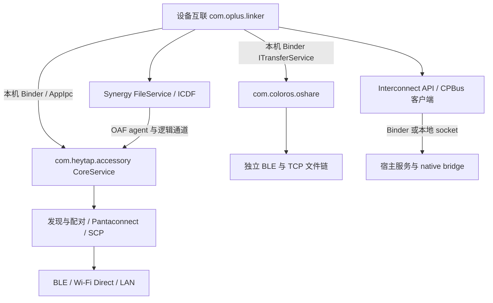

# ColorOS 17 设备互联协议分析

分析日期：2026-11-08。对象：一加 Ace 6（OnePlus PLQ110），构建 `PLQ110_17.0.0.104(CN01)`，Android 17 / API 37。本文对应这次导出的具体二进制，不代表其他机型、地区或后续版本。

当前研究目标已明确为 **ColorOS ↔ ColorOS**。优先阅读[专项协议说明](coloros-to-coloros-protocol.md)：它补充了同账号 OOBKEY/非同账号 UKEY2 分流、完整的 SCP 握手阶段、TCP 写入边界以及重建的控制消息 schema。本文保留包级总览、辅助协议和原始证据。

## 结论与完成边界

已完成六个 APK 的反编译、Manifest/权限筛查、主要 IPC 路径追踪，以及部分设备间报文编码、认证和文件传输代码分析。关键发现如下：

1. **“设备互联”不是独立的一套传输协议。** `com.oplus.linker` 将发现和连接委托给 `com.heytap.accessory` 中的 Pantaconnect；文件业务至少存在 OAF/ICDF 与 OShare 两条不同路径。最初五个 APK 不包含全部底层实现，本次已补充导出并分析 AccessoryFramework 17.6.16。【E02、E03、E31、E40、E41】
2. **已找到可复核的设备间协议片段。** Pantaconnect 有 BLE 服务数据解析、UDP `239.255.255.250:10150` / 单播 `10151`、TCP 探测 `10150`、SCP 二进制头与 Protobuf 控制消息；认证存在 UKEY2 `P256_SHA512`、额外 PIN/自定义认证，以及独立的 AES 封装。OShare 有实际 BLE 扫描和 TCP 二进制文件编码器。【E11–E30、E33–E39】
3. **普通第三方 APK 不能因为拿到 AIDL 就直接获得系统互联能力。** 部分入口是 `signature|privileged`；另一些 Manifest 权限虽为 `normal`，服务内仍检查调用 UID/PID 的 OCS 授权。没有验证任意第三方包能通过授权。【E01、E04–E08、E32】
4. **新 CPBus 的 API/符号不等于可用实现。** 本构建 `libcpkit.so` 的 `nativeStartPair`、`nativeConfirmPair`、`nativeIsPaired` 等函数只有 `mov w0,wzr; ret`，相关 GATT 回调也有直接 `ret`。不能据此宣称新 CPBus 配对链已还原或可工作。【E09】
5. **尚未完成两台 ColorOS 的会话实测。** 本次没有发起扫描、配对、安装测试客户端、抓包或传文件；只执行了只读 ADB 查询和公开系统 APK 导出。这里的“静态已证实”表示二进制中存在相应实现及调用证据，不表示该分支在当前 UI 操作中实际被选择。

后续重点是核对两个 ColorOS 样本的协议版本与设备角色，补齐 NDSF 同账号认证和选定业务通道，并用真实会话验证静态还原结果。系统互联的 SCP、FastPair 与 OShare 分享必须分别追踪。

## 样本、工具与证据定位

原始清单：`captures/device-interconnect-20261108/coloros17/manifest.json`。原始五个 APK 保持不变，导出方已记录设备/本地 SHA-256 一致和 ZIP CRC 通过。

| 包 | 版本 | 本次处理与定位 |
| --- | --- | --- |
| `com.oplus.linker` | 17.7.30 / 170070030 | 主包；发现 API、互联 IPC、Synergy 文件业务、OShare 桥接 |
| `com.heytap.accessory` | 17.6.16 / 170060016 | 本次补充；实际 Pantaconnect、OCS、发现、配对、SCP 与传输实现 |
| `com.coloros.oshare` | 17.2.36 / 17002036 | 已沿主包调用确认相关；BLE 与独立文件通道 |
| `com.oplus.nearcomm` | 17 / 37 | 主要为通话/SMS 协同，不能按中文标签当作通用发现引擎 |
| `com.heytap.mydevices` | 17.25.10 / 1725010 | 已反编译筛查；设备插件、管理和 UI，未列入本次最小文件传输关键链 |
| `com.oplus.devicehub` | 17.01.90 / 170190 | 已反编译筛查；三方设备和分布式存储入口，未证明为手机间发现/配对必经项 |

补充 APK 原路径：`/product/priv-app/AccessoryFramework/AccessoryFramework.apk`，53,155,205 字节，SHA-256：

```text
538e5665ea6c709827063cc8b2f2dc86c82d432252c41ca4606526be7497ec78
```

设备端哈希一致，ZIP CRC 通过；APK、设备端哈希和包信息保存在本侧 `analysis/dependencies/com.heytap.accessory/`。

使用 [JADX 官方发布版 1.5.6](https://github.com/skylot/jadx/releases/tag/v1.5.6)、Androguard 4.1.4、Android SDK aapt 37.0.0、NDK 29 的 `llvm-readelf` / `llvm-objdump`。JADX 下载包 SHA-256 与 GitHub release API 的 digest 一致：`545ea2be9c242511bc145755cf4bda2485ade42966e096f8b4d3da2a230e8974`。

全部工作产物位于：

```text
captures/device-interconnect-20261108/coloros17/analysis/
  apk/<package>/               Manifest、APK/证书摘要、SO、ELF 符号、带偏移字符串
  jadx/{linker,accessory,oshare,nearcomm,mydevices,devicehub}/
  jadx/accessory-clean/        关闭有问题的 Kotlin metadata 插件后的第二次输出
  dalvik/                     关键方法的原始 DEX 指令、DEX SHA-256、code_offset
  native-disassembly/         关键 ARM64 函数反汇编
  evidence-index.json         51 项证据的文件、行段、完整文件 SHA-256
  evidence-excerpts.md        同一批证据的带行号摘录
```

本文 `L/`、`A/`、`O/` 分别指 `analysis/jadx/linker/sources/`、`analysis/jadx/accessory/sources/`、`analysis/jadx/oshare/sources/`。行号均指这些固定生成文件，并非厂商原始源码行号。`【E编号】` 可在[证据摘录](../../captures/device-interconnect-20261108/coloros17/analysis/evidence-excerpts.md)及[哈希索引](../../captures/device-interconnect-20261108/coloros17/analysis/evidence-index.json)中复查；captures 被忽略，其他 checkout 需要同时取得这份证据目录。

JADX 初次报告错误数：linker 111、nearcomm 0、oshare 51、mydevices 210、devicehub 213、accessory 9628。Accessory 大量错误来自畸形 Kotlin metadata；关闭该插件后的独立重跑降至 172。错误数不是“失败类数量”，也不表示其余代码自动正确。关键权限检查、UKEY2 类型、认证封装、SCP 编码、OShare 编解码已另存原始 Dalvik 指令用于交叉核对。未把反编译器生成的 `UnsupportedOperationException("Method not decompiled...")` 当作原应用行为。

## 组件关系及 IPC 边界



**静态已证实：** `DiscoveryImpl.startSearch()` 调用 `ConnectionService.startGlobalDeviceDiscovery()`，`stopSearch()` 调用相应停止 API。`ServiceConnectivityImpl` 使用 `setClassName("com.heytap.accessory", "com.oplus.pantaconnect.service.CoreService")` 然后 `bindService`。这一步是本机 IPC，不是发现报文格式。【E02：L/com/oplus/linker/connect/arch/discovery/DiscoveryImpl.java:100–149；E03：L/com/oplus/pantaconnect/sdk/ipc/ServiceConnectivityImpl.java:160–187】

Pantaconnect `CoreService.OuterIpcInterfaces.request()` 接收方法名、字符串参数、字节数组和 Bundle；检查调用 UID/PID，通过 `scope` 选择 dispatcher，再按 `is-async` 回调。主包自己的 `InterconnectService` 则暴露 `IInterConnIpcInterface`，还支持 `data_bundle`、`serialization_type`、`call_process_binder` 一类本地参数。**这些 Bundle 字段、Binder transaction 编号及 Parcel 布局不属于设备间 wire protocol。**【E05、E08；A/com/oplus/pantaconnect/service/CoreService.java:113–161】

`NativeIpcClient.callWithBufferSize()` 拼接 `socketDir + "/interconnect.sock"`，请求方法拼成 `service.method`，默认响应缓冲 65536 字节；连接错误 `-2` 重试最多 5 次、递增等待。配套 JNI 符号是 `Java_com_oplus_interconnect_base_api_ipc_NativeIpcClient_nativeCall`，位于主包 `libinterconnect_ipc_client.so` 的 `0x31420`。**这条已追到的路径是本机 UNIX socket IPC，不能把 65536 或 interconnect.sock 当作 LAN 端口/帧大小。**同库的 `RpcChannel.nativeConnectOnTransport` 还允许跨设备 transport 桥接；未完整恢复其 native RPC framing。【E10；apk/com.oplus.linker/libinterconnect_ipc_client.elf.txt:106–120】

## 设备发现与连接

### Pantaconnect 局域网发现

| 已证实的操作 | 地址/参数 | 证据与限制 |
| --- | --- | --- |
| UDP 组播 socket | `239.255.255.250:10150` | `GeneralSocket` 对应 A/.../discovery/adapter/lan/g.java `c()`，创建 MulticastSocket；TUNNEL 分支按接口地址绑定 DatagramSocket。【E11】 |
| UDP 单播 socket | 接口 IPv4 的 `10151` | 同文件 `d()` 实际 bind。【E11】 |
| TCP 探测 | 远端 `10150`，connect timeout 5000 ms | A/.../discovery/adapter/lan/c.java:25–26。【E12】 |
| 后续 LAN 连接端口 | `10152` | AnnouncePacket 的 connectionServicePort 默认值；A/.../connectionservice/active/k.java:109 将远端地址与 10152 构成连接地址；Connector 管理实际 ServerSocket bind 在 A/.../connector/connection/j.java:506–507。未做实机监听检查。 |
| 发现服务标签 | `scp.device` | Query/Announce/Senseless 等默认 networkService；不是 mDNS 服务类型。【E13】 |

不要因组播 IP 与 SSDP 常见地址相同就认定其为 SSDP：这里端口为 10150，实际 packet 编解码有厂商 JNI 路径。

`AnnouncePacket` 的可见字段为 `networkService`、`discoveryServicePort`、`connectionServicePort`、`delayMillis`、`protocolDeviceId`、`accountDigest`、`deviceType`、`deviceName`、`networkServiceData`、`virtualIp`。其中 `nativePackAnnounce(byte[]) -> AnnouncePacket` 与 `nativeUnpackAnnounce(AnnouncePacket) -> byte[]` 的命名方向与直觉相反，应按签名理解。【E13：A/com/oplus/pantaconnect/discovery/lanprovider/packet/AnnouncePacket.java:26–50、180】

**未知：**这些 Java 字段并不证明 UDP 线上使用 JSON、TLV 或固定偏移。`libcpkit.so` 有对应的真正 JNI 编解码函数，以及 Query、Register 等编解码符号；本次完成符号和调用边界定位，未完成这些 native 函数内部的数据格式还原。不能按字段顺序直接构造兼容 UDP 报文。

### BLE 与 mDNS/NSD

**静态已证实：**Pantaconnect BLE 扫描结果代码实际调用 `ScanRecord.getServiceData(ParcelUuid)`。其常量构造出 `0x6868`、`0x686b`、`0xafaf`、`0xfd70`、`0xfe70`、`0xfc70`、`0x7280` 等 UUID（标准尾缀 `-0000-1000-8000-00805f9b34fb`）；E17 中分别可见服务数据读取分支。并非这些 UUID 都代表手机互联同一模式，不能全都塞入统一适配器当作等价发现标志。【E16：A/.../discovery/bleprovider/advertise/b.java:8–37；E17：A/.../discovery/bleprovider/scan/c.java:125–165、480–610】

**静态已证实：**NSD 适配器调用 Android `NsdManager.discoverServices(serviceType, 1, listener)`；枚举扫描分支只接受规范化后的 `_http._tcp`，不支持的类型返回 `NSD_SCAN_FAILED_SERVICE_TYPE_IS_NOT_SUPPORTED`。这支持“存在基于 Android NSD 的 DNS-SD/mDNS 路径”，但没有证明每次手机发现都走它，也没有从这段代码得到一个固定的 `_oplus._tcp` 类型。【E14、E15】

### Wi-Fi Direct

**静态已证实：**`WifiP2pManagerWrapper` 对应 `A/com/oplus/pantaconnect/net/wifi/p2p/b0.java`，`a()` 实际调用 `WifiP2pManager.createGroup`，`b()` 请求连接信息；同类持有 `OplusWifiP2pManager`。配对目录中有 Provider/Seeker 的 Wi-Fi Direct 建网阶段和加密协商数据处理。【E18；A/com/oplus/pantaconnect/pair/connecting/wifidirect/c.java:136、172、217；e.java:140、175】

**合理推断：**蓝牙/发现链用于找到对端与协商，文件/高带宽业务可以升级到 Wi-Fi 链路。**尚待动态验证：**当前“设备互联”的具体操作选择 P2P、已有 WLAN、SoftAP 还是其他连接器；GO/GC 角色、频段、重用已有组及离线回退策略。

## 配对、认证与会话

### UKEY2 分支

**静态已证实：**`dn.c.a()` 与 `en.c.a()` 分别创建 UKEY2 客户端/服务端，明确选择 `P256_SHA512`。客户端 `dn.b.a()` 消费对方握手数据、产生下一条握手消息，再从握手结果取密钥材料；服务端 `en.b` 有对应处理。这里只能说选择了这一密码套件和库实现，不能据此声称与其他厂商的 UKEY2 外层格式相同。【E19、E20；A/en/b.java:22–54；dalvik/accessory/dn.c.txt、en.c.txt】

FastPair 的 UKey2Generator（混淆类 `com.oplus.pantaconnect.pair.keygenerator.e`）实际发送以下类型字节：

| 类型 | 值 | 已追到的行为 |
| --- | --- | --- |
| `MESSAGE_CLIENT_INIT` | `0x10` | 类型字节拼接 UKEY2 client-init 数据 |
| `MESSAGE_SERVER_INIT` | `0x11` | 对方消费 client-init 后生成 server-init |
| `MESSAGE_CLIENT_FINISH` | `0x12` | 包含厂商附加的加密数据和 UKEY2 finished 数据，存在版本/设备类型分支 |
| `MESSAGE_SERVER_FINISH` | `0x13` | 解密并校验对端 finished 数据及去重相关信息 |

证据：E21 的 `a()/f()/h()`；常量另外直接核对 `classes3.dex` 的枚举 `<clinit>`，保存于 `dalvik/accessory/com.oplus.pantaconnect.connection.pair.PairMessageType$UKey2.txt`，`code_offset=0x2c8cc4`，指令明确载入 16、17、18、19。**这四个数是本分支 Payload 类型，不能混同下节 SCP Protobuf 的 msgType。**

继续追到 `PairMessageScheduler`（`pair.h.b()`）后，可确认交给连接器前还有一层：`type:uint8 | dataLength:uint16BE | data`。上表 UKEY2 init 的 `data` 自身已含类型字节，因此该分支出现外层 type 与内层 type 重复；不能“去重”后再发。认证请求则把下节的 `tag8 || random8 || ciphertext` 放进这个 data。此处已证实到连接器发送入口，仍未确认每种 BLE/TCP 连接器的后续分片。【E51：A/com/oplus/pantaconnect/pair/h.java:45–51；E47】

### PIN/自定义认证阶段

`AuthenticationType` 定义 `SKIP_AUTHENTICATION`、`PIN_AUTHENTICATION`、`CUSTOMIZE_AUTHENTICATION`。`PairAuthenticationImpl`（混淆类 `pair.g`）在 PIN 分支调用上层挂入的异步 callback，等待输入内容；这与密码学密钥交换是分开的阶段。不能因为 UKEY2 内部调用了完成/验证方法就断言用户已经点击确认。【E22、E23】

已恢复的一种认证请求封装为：

```text
tag8 || random8 || ciphertext
tag8 = HMAC-SHA256(K, random8 || ciphertext) 的前 8 字节
ciphertext = AES/CTR/NoPadding(K, IV, authenticationContent)
```

发送路径使用 `SecureRandom` 生成 8 字节随机数，接收路径分别取 `[0:8]`、`[8:16]`、`[16:]`，重新计算 HMAC 并比较后再解密；明文还检查 messageType 和单字节长度。`K/IV` 来自该配对上下文的共享材料，**不是从设备读取的实际凭据**。【E22：A/com/oplus/pantaconnect/pair/g.java:380–401、470–503】

JADX 此处存在协程控制流重建问题，因此额外交叉核对了原始 DEX：`g.f` 的 `code_offset=0x3eb914` 和 `g.h` 的 `0x3ebc08`；AES/CTR、HMAC、切片和长度常量均可在 `dalvik/accessory/com.oplus.pantaconnect.pair.g.txt` 复查。未恢复全部认证结果码、UI 显示和所有错误分支。

### 会话生命周期

**静态已证实的片段：**SCP 在握手完成前丢弃 BUSINESS payload；收到 DISCONNECT 按状态处理；SYNC 接收使用 5000 ms 超时；本机服务注册 Binder death recipient，客户端死亡时清理 dispatcher 资源。OShare TCP 文件服务有关闭 socket、unbind、dispose 和端口状态清理代码。【E24：A/.../pair/scp/d.java:369–381、487；E05；E36】

**未知：**用户取消能否跨所有 transport 及时清理、后台进程重启后是否恢复旧授权、配对记录撤销与账号变更如何传播，以及真实重连时密钥/IV 的更新规则。已看到配对和账号密钥持久化代码目录，但没有读取其运行时数据库或存储内容。

## SCP 控制消息与能力交换

这里的 SCP 是 APK 内的厂商协议名称，**不是 SSH 的 Secure Copy**。

### 外层 framing

`RealScpProtocol.l()` 构造 Protobuf 控制消息、按共享材料是否存在加密、填写 payloadLength，调用 `kotlin.collections.e0.E()` 编码，再交给连接器 `Payload`。默认版本取 `ScpVersion.V4`；兼容解析器另外支持旧版分支。【E24、E25；A/.../connection/scp/x.java:14–17】

对已追到的普通主头，编码器顺序如下，整数为网络大端：

| 偏移 | 大小 | 字段 |
| --- | --- | --- |
| 0 | 1 | 高 4 位 version，低位 serviceType |
| 1 | 1 | 高 4 位 payloadType；bit3 加密标志；bit2 server 标志；低 2 位 structType |
| 2 | 2 | payloadLength |
| 4 | 1 | nextHeader，END 或扩展头类型 |
| 5 | 1 | bit1 isHello、bit0 isCrcEnable（本编码器） |
| 6 | 2 | crc 字段 |
| 8 | 4 | agentAddress |
| 12 起 | 可变 | 可选扩展头，再接 payload |

证据：E25 `A/kotlin/collections/e0.java:131–157`；E26 的字段命名；E47 `component/common/a.z()` 输出两字节大端。agentAddress 由 `SHA-256(namespace + channel)` 的末 4 字节生成，再从十六进制字符串转回字节。【E27：A/.../connection/scp/a.java:19–34】

注意：SCP 兼容解析器 `A/com/oplus/pantaconnect/scp/e.java:19–79` 确认最低 12 字节和 4 字节地址，但其旧版分支位布局不同。扩展分片头在 JADX 输出中出现布尔/字节类型重建异常；本次只确认存在该扩展链，**不提供可互操作的完整分片编码实现**。未验证 CRC 算法和适用条件。后续专项追踪已确认 `TcpSocketConnectionImpl.e()` 直接写入 SCP 字节，不另加 FastPair 前缀；其他连接器仍需分别核对。

### Protobuf 和加密

外层控制 Protobuf `A/com/oplus/pantaconnect/connection/scp/e0.java` 中 `msgType` 为 field 1，`data` 为 bytes field 2，实际 `toByteArray()` / `parseFrom()` 调用均已追到，故不是仅发现生成类。【E24、E28】

控制类型为 `HELLO=0`、`SYNC=1`、`SYNC_SECURE=2`、`UKEY2_INIT=3`、`UKEY2_FINISHED=4`、`OOBKEY_BUILD=5`、`OOBKEY_PROCESS=6`、`OOBKEY_FINISHED=7`、`DISCONNECT=65535`。【E48】

当会话共享材料非空时，SCP 发送链调用 `kotlin.collections.z.c()`，使用 `AES/GCM/NoPadding` 与 128-bit tag；接收链调用 `ym.a.l()` 解密。没有共享材料时发送普通 Protobuf。**这是 SCP 控制层的状态分支，不是“所有互联数据一律 AES-GCM”的证据。**本次没有恢复每条消息 IV 的生成/变化规则，不能据静态 cipher 调用评价完整会话安全性。【E24、E30；A/com/heytap/smarthome/iot/util/Config.java:7；A/ym/a.java:1129–1130】

SYNC 的字段已能和实际 builder 对上：

| Protobuf field | 字段 |
| --- | --- |
| 1 | deviceName |
| 2 | keyType |
| 3 | customData |
| 4 | deviceType |
| 5 | activeTriggerMode |
| 6 | modelId |
| 7 | linkType |

接收端在缺少 linkType 时回退 WLAN。【E24：`m()` / `h()`；E29】这证明存在设备、链路及密钥类型同步；它还不能替代项目 `core` 所需的“任意业务能力列表”。OAF 的 URN/profile、连接策略和服务能力仍是另一层，未恢复一份跨所有业务的统一能力协商 schema。

## 文件传输的两条路径

### 主包的 Synergy / OAF / ICDF 文件业务

已验证调用链：`IcdfManager.writeFile()` 派发场景 → `FileTransferScene.writeFile()` → `FileServiceConsumerImpl` → `FileServiceConsumer` / gRPC 风格 stub。Provider 侧 `FileServiceProvider` 指定 `FileServiceImpl`，其 read/write 操作转给本机业务 callback。Provider/Consumer 在 accessoryservices.xml 注册 `app:fileservice:1.0`，逻辑 channel 104，并另列 channel 110。【E40、E41；L/.../wisetransfer/IcdfManager.java:138–143；L/.../fileservice/scene/FileTransferScene.java:101–125；L/.../icdf/FileServiceProvider.java:12–20、44–47】

`FileServiceConsumer` 明确 `configMethod("FileService/writeFile", 2, 104, false)`，发现对端时还检查 transportType 和对端应用名。**104/110 是 OAF 逻辑通道号，不是 TCP 端口。**【E41】

业务方法：`FileService/createFile`、`deleteFile`、`openFile`、`readFile`、`writeFile`；生成方法描述位于 `L/com/oplus/linker/synergy/FileServiceGrpc.java:291–428`。Protobuf 字段如下：【E42】

| 消息 | 字段号和名称 |
| --- | --- |
| FileInfo | 1 filepath；2 length；3 flags；4 uri；5 pcFilePath；6 extras |
| FileData | 1 info；2 length；3 buffer；4 flag；5 uri |
| FileResult | 1 status；2 info；3 file |
| FileStatus | 1 status；2 length |

存在 readFile 返回数据流、writeFile 接收数据/返回状态的业务代码，但底层使用 `io.grpc.oaf` / ICDF 通道，**未证明它就是可直接连接的标准 HTTP/2 gRPC 服务器**。没有找到并验证一个可给普通外部客户端使用的固定 gRPC TCP 端口。

`FileServiceUtils.checkFileTransferResult()` 在该方法内只比较实际长度与声明长度，不能把这一检查写成 SHA-256 完整性验证；更底层是否还有校验未完全追完。【E43】

`FileTransferCmdBody` 和 `SynergyMessage` 还保留 JSON 模型（cmd、fileServerIp、fileServerPort、sessionCode 等），但已追到的文件入口会派发场景/构造 Protobuf。**JSON 数据类及命令常量本身不证明它们在当前文件路径上实际发送。**【E46；L/.../protocol/filetransfer/FileTransferManager.java:125–131】

### 主包委托 OShare 的文件路径

`OShareTransferClientImpl` 实际调用 `com.coloros.oshare.FileTransferManager`；SDK 以 action `com.oplus.oshare.FILE_TRANSFER_SERVICE` 绑定 `com.coloros.oshare`（或另一地区包名）。这确认 OShare 与主包相关，但每种对端/分享动作选择哪个实现仍需运行验证。【E31、E50】

OShare 的 BLE 代码与 Pantaconnect 上述发现代码分开：

| 标识（标准 Bluetooth UUID 尾缀，除特别注明） | 有代码调用的用途 |
| --- | --- |
| `0x3333` / `0x3334` | 扫描读取两份 serviceData；广播代码发布对应数据/UUID |
| `0x6666` / `0x6667` | 扫描读取的另一组 serviceData；广播代码有对应构建 |
| `0x8881` | 扫描 filter 与结果分支 |
| `00003331-0000-1000-8000-008123456789` | 扫描 filter，不能套标准尾缀 |
| `0x9999` | GATT client 实际查找的 service |
| `0x9997`、`0x9984` | 已看到设置 characteristic notification 的路径 |

证据：E33 常量表、E34 `BleScannerImpl` 的 `startScan` / `onScanResult`、E35 广播；`O/com/oplus/oshare/ble/impl/j.java:234、1313–1326`。未完整恢复广播位图和各 GATT characteristic 的分片/认证语义，不能把不同模式的 UUID 当作等价发现标志。

OShare TCP 文件服务器 `mb.n.t()` 实际设置 Apache MINA `ProtocolCodecFilter(new mb.c())` 并 bind。普通分支/回退端口为 **8959**；存在分配/协商端口的其他分支，因此不是永远固定 8959。另建文件 socket 服务使用 `port+1`，失败回退 **8960**。【E36：O/mb/n.java:439–490】

`mb.f` 编码器、`mb.d` 解码器能够互相核对以下 framing。字节序由 MINA 的 SimpleBufferAllocator 显式设置为 BIG_ENDIAN。【E37–E39、E49】

```text
公共前部：int32 id | int32 dataType | int64 lengthField

dataType=0x1000 命令：
  int32 command | int32 utf8ByteLength | utf8Bytes | int32 flags
  lengthField = 上述命令 body 的字节数

dataType=0x4000 心跳：
  int32 value
  lengthField = 4

dataType=0x2000 文件：
  int64 metadataRegionLength
  int32 utf8ByteLength | utf8Name
  int32 metadataValue | int64 fileSize | int32 flags
  随后 fileSize 个文件字节
```

重要细节：文件编码器 `mb.i.c()` 把 offset 8 的 lengthField 写成**整个已编码头/元数据区长度**，并非命令分支的 body 长度，更不是 fileSize；offset 16 的 metadataRegionLength 从自身位置计长。文件发送实际调用 `FilenameFileRegion` 写数据，接收代码按 fileSize 逐步写 FileChannel。`metadataValue` 的业务语义没有充分追到，因此保持中性名称。【E38：O/mb/i.java:30–47；E37：O/mb/f.java:107–133；E39：O/mb/d.java:240–284】

MINA 心跳设置为 requestInterval 10 秒、requestTimeout 30 秒；退出路径清理服务器和辅助 socket。尚未把所有 command 数值、双向收发 UI 确认、恢复点与取消状态串成一条完整会话。【E36】

未在这些 codec/该服务器 filter 链内看到 TLS 或 payload cipher，并不意味着所有 OShare 模式都无加密：同包还有独立 iOS WebSocket/HTTP、加密工具和版本分支。尤其 `fa.x` 的 UDP `port+1` 代码发送随机数据计算 `wlanBandwidth`，是测速路径，**不是由此得到的 UDP 文件协议**；不应把它与上述 TCP 8960 文件 socket 混同。

## JNI 与辅助包筛选

| 项目 | 可证实结论 | 证据限制 |
| --- | --- | --- |
| linker `libinterconnect_ipc_client.so` | JNI IPC/RPC 客户端；有本地 socket 和可插入的跨设备 transport 桥 | native RPC 的完整 framing 未恢复 |
| accessory `libcpkit.so` | 多个真实发现/序列化 JNI 实现；另外包含新的 CPBus 占位接口 | 不能按名字一律认定实现存在 |
| accessory `libinterconnect.so` | `NativeBridge` / `RpcServer` 宿主 JNI，导出 dispatch、stream、registerHandler 等 | 宿主框架不等于手机间全部业务协议 |
| linker `libomes_srp_si.so` | `com.oplus.omes.srp.sysintegrity.Probe` 加载库并调用 `getProbeRespStr`；native `JNI_OnLoad` 在 0x1e704 | **名字 srp 不是 Secure Remote Password 配对算法的证据**【E45】 |
| linker `libnaiveEngine.so` | JNI 属于 `com.oplus.vfxsdk.naive.coe.engine`，依赖 GLES/EGL 等 | 当前证据属于渲染，不列为互联认证关键库 |
| `com.oplus.nearcomm` | profile 为 `oaf.service.call:1.0`、`oaf.service.iphone.call:1.0`、`oaf.service.sms:1.0`；Manifest 使用 system shared UID | 是通话/SMS 相关消费者/提供者，未发现其为本次文件链必经项【E44】 |
| MyDevices / DeviceHub | 已完成全包反编译筛查；存在设备插件、存储和外设适配入口 | 没有证明其完全无关，只是目前代码链未要求把它们作为手机文件互传底层 |

CPBus 反例的具体地址（`libcpkit.so`，ELF 虚拟地址）：

```text
0x334f84 nativeOnFastPairBleNotification : ret
0x334fa8 nativeAcceptPair               : mov w0,wzr; ret
0x334fb8 nativeConfirmPair              : mov w0,wzr; ret
0x334fc0 nativeIsPaired                 : mov w0,wzr; ret
0x334fd0 nativeStartPair                : mov w0,wzr; ret
```

这里仅证明这些具体函数为占位；不代表同库全部功能为占位，也不代表既有 Java Pantaconnect 配对失效。【E09，原文件 `native-disassembly/cpkit-cpbus-pair.txt`】

## 第三方适配器的接入边界

| 入口 | Manifest/系统保护 | 服务内检查 | 对普通 APK 的含义 |
| --- | --- | --- | --- |
| SynergyCoreService / 多个设备互联服务 | `com.oplus.permission.safe.CONNECTIVITY`，设备确认为 `signature|privileged` | 本文未完整列举所有业务检查 | 不能靠声明 uses-permission 取得权限 |
| FileShareEngineService | `com.oplus.synergy.permission.ENGINE`，Manifest 值 3 | 另有业务状态 | 是受保护入口 |
| InterconnectService | `com.oplus.interconnect.permission.SERVICE`，设备确认为 normal | OCS 校验调用 UID/PID，失败返回错误数据 | 能 bind 不代表能调用业务 |
| accessory CoreService | `com.oplus.pantaconnect.permission.CONNECTIVITY`，normal | OCS，非 1001 返回空数据 | 需要验证合法应用授权路径 |
| CpbusHostService | `com.oplus.permission.safe.CONNECTIVITY` | JNI 实现还存在占位 | 既有权限门槛，也有实现完整性问题 |
| OShare FileTransferService | `com.oplus.oshare.permission.OSHARE_SWITCH`，设备确认为 `signature|privileged` | 还有业务状态/回调 | 当前 SDK 不是普通第三方免授权传输入口 |

证据：E01、E04–E08、E32。OCS `check()` 使用调用包名、UID/PID、能力名 `OAF_CLIENT` 和配置公钥；有受保留 UID、缓存及设置分支。本文没有改动任何设置或尝试规避授权，也没有测试某个第三方包是否被厂商授权。权限结果必须与实际签名/安装身份分开评估。

另外从 APK 各签名格式提取了**证书集合的 SHA-256**，保存在 `apk/<package>/inventory.json`：linker、accessory、nearcomm、devicehub 含相同证书摘要 `e4980240...100bf9e`；OShare/MyDevices 返回另一组摘要。该集合可能跨签名版本/轮换记录，**不据此断言当前多签名、系统平台签名关系或全部权限授予原因**。没有取得任何私钥。

可行边界：

- **厂商 SDK 接入：合理推断可研究，尚未验证可获得授权。** 先用普通签名最小测试 APK 验证组件解析、bind、无副作用能力查询及明确错误；若权限/OCS 阻止，应记录为“不支持”，不把 root、共享 UID 或签名伪装当作普通适配方案。
- **线上协议适配：部分可研究。** SCP 的头与消息类型、UKEY2 套件并不自动解决发现包、外层 GATT/TCP 分片、用户确认、密钥派生及能力协商。现有结果足以设计被动匹配和离线 decoder，不足以宣布替代客户端完成。
- **本节只是应用接入边界。** 系统自身的 ColorOS ↔ ColorOS 通信应继续沿真实发送/接收链还原，不能把 AIDL 或自定义替代通信方案当作线上协议答案。

## 两台 ColorOS 的最小验证顺序

本报告没有读取另一侧分析文件，也没有修改共享文档。以下为后续验证清单，本次未执行需要改变设备状态的步骤。

1. **核对对端 ColorOS 样本。** 记录对端机型、系统和 AccessoryFramework 版本，核对 SCP 版本、HELLO/SYNC 字段和角色条件，不能仅根据系统名称认定完全相同。
2. **区分系统互联与系统互传。** 选定实际功能后判断走 SCP、OAF/ICDF 还是 OShare，分别建立会话记录。
3. **由用户明确触发一次发现/取消。** 在隔离测试网络中观察两台自有设备的 BLE 广播、mDNS 与上述 UDP/TCP 端口；只保留必要元数据及测试会话，避免捕获其他设备与用户内容。将每个事件映射回实际调用栈或协议解析器。
4. **验证用户确认与拒绝。** 使用测试会话，核对两端显示、接受、拒绝、超时、撤销；验证密钥交换完成是否仍等待用户决定。记录阶段和错误码，不保存实际密钥/账号凭据。
5. **验证最小文件闭环。** 先 A→B、再 B→A，各发送自建 1 KiB 随机测试文件；在发送前与接收后计算 SHA-256，记录协议版本、实际 transport、端口、字节数和时序。再测零字节/非整块长度、取消、断网和重连。不能仅凭长度或 UI“成功”认定内容一致。
6. **分别验证账号分支。** 核对同账号 OOBKEY、非同账号 UKEY2 和 keyType 不匹配时的行为，继续补齐 NDSF 与实际 UI 确认条件，不记录真实密钥。

## 尚未解决的具体问题

| 未知项 | 已有证据到达的位置 | 下一步需要的证据 |
| --- | --- | --- |
| LAN 发现 packet 的完整字节布局 | Java 模型 → libcpkit JNI | native 内部解析/编码分析及合成样本对照 |
| Pantaconnect BLE 广播与 GATT 全部字段 | UUID、读取/广播路径、部分配对类型 | 针对选定模式的编码器、分片及实机观测 |
| 哪条链由当前 UI 实际选用 | 主包到多个实现的静态调用 | 用户操作对应的受控运行跟踪 |
| UKEY2 厂商附加数据与全部密钥派生 | P256_SHA512、若干 finished 数据及上下文赋值 | 完整角色/版本矩阵、KDF/nonce 生命周期 |
| SCP fragment、CRC、连接器包边界 | 12 字节主头、扩展链、payload codec | 原始指令/native 继续分析与报文对照 |
| 业务能力协商全集 | ScpSyncData、URN/profile | 实际 service capability request/response 全链 |
| OShare 全部 command、版本与认证 | TCP 编解码、BLE/GATT 调用 | 选定 Android 手机分支的状态机闭环 |
| ICDF/OAF 底层完整线上格式 | FileService 方法和 Protobuf、逻辑通道 | OAF transport framing、连接协商与密钥层 |
| 第三方合法授权是否可获得 | Manifest + OCS 实现 | 普通签名测试应用与厂商授权契约 |
| ColorOS 版本/角色兼容性 | 本侧可比较的协议片段 | 第二个 ColorOS 样本、实际角色与双向会话测试 |

## 复现和交付检查

研究脚本均在本侧 `analysis/`：

- `prepare_evidence.py`：从公开 APK 提取 Manifest、签名证书摘要、SO、ELF 符号、字符串与 CRC/hash 清单。
- `dump_dex_evidence.py`：从指定 DEX 导出关键方法的原始指令，不执行 APK。
- `build_evidence_catalog.py`：验证 51 项源文件/起始行，生成证据摘录与文件哈希索引。
- `show.py`：按固定行号读取源码片段，省略超长元数据展示。
- `verify_analysis.py`：复核原始五个 APK 未变、补充 APK 的设备端哈希、全部证据文件哈希、报告链接和证据编号；结果保存为 `verification.json`。

工具和反编译日志保留在 `analysis/tools/` 与 `analysis/jadx-*.log`。关闭 Kotlin metadata 插件的第二次输出未覆盖第一次证据，因此本文行号仍可稳定复查。没有修改另一侧目录、README、共享架构文档或 .gitignore；没有提交或推送 Git。
