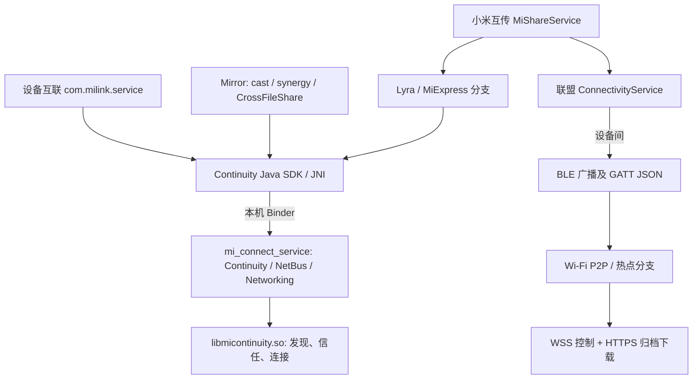

# HyperOS 4「设备互联」协议分析

分析日期：2026-11-08（Asia/Shanghai）。对象：Xiaomi Pad 8 Pro / 25091RP04C，OS4.0.5.0.XPYCNXM，Android 17 / API 37。范围为已导出 APK 的静态分析，加上指定设备的只读系统库/构建信息查询；**没有进行配对、主动扫描、传输、安装或抓取用户数据**。

## 结论与适配方向

1. **静态已证实**：“设备互联”主包并不是单一无线协议实现。其 `shared_channel`、组网入口以及 Mirror 协同服务使用 Continuity/Lyra；较底层的服务、发现和认证位于 `com.xiaomi.mi_connect_service` 及本地库。Android Binder 的 transaction 编号、Parcelable 字段和 ServiceName 均不能直接当成网络报文。
2. **静态已证实**：“小米互传”同时保留 Lyra、互传联盟、联盟一碰传和 AirDrop 分支。与本项目“小文件双向传输”最直接相关、当前还原程度最高的是 **联盟 BLE/GATT → Wi-Fi P2P → WSS 控制 + HTTPS 文件下载**路径。分流有实际代码支持，并非根据应用名称推测。[S/com/miui/mishare/connectivity/MiShareService.java:1589](<E:/强兼互联/captures/device-interconnect-20261108/hyperos4/analysis/jadx/com.miui.mishare.connectivity/sources/com/miui/mishare/connectivity/MiShareService.java:1589>) [S/com/miui/mishare/connectivity/MiShareService.java:1922](<E:/强兼互联/captures/device-interconnect-20261108/hyperos4/analysis/jadx/com.miui.mishare.connectivity/sources/com/miui/mishare/connectivity/MiShareService.java:1922>)
3. **合理推断**：优先验证普通第三方 Android 应用绑定本机 `MiShareService`，复用系统的联盟发现与传输；其 Manifest 绑定权限为 `normal`。直接重实现 Lyra 或移植整个小米系统 APK 的成本和权限障碍明显更大。**这里尚未验证任意第三方签名 APK 的运行可用性**。
4. **需要动态验证**：ColorOS 17 是否支持同一 UUID、GATT 参数、WSS 消息和文件封装；两方向是否成功；是否弹出用户确认；断线/拒绝/取消是否一致。本报告没有读取另一端分析结果，也没有把“小米代码包含联盟路径”表述为“两个系统已经互通”。
5. **证据限制**：已恢复联盟应用层协议的主要路径和 Lyra 上层调用链；未恢复 Continuity 的完整 native 握手、账户证明、密钥派生和底层帧格式，不能据此实现兼容的独立 Lyra 对端。

## 1. 样本、方法和证据口径

版本取当前导出 APK 的 Manifest/badging，不取 dumpsys 中可能并存的旧系统包版本。原始文件未改动；本轮再次校验六个 APK 的 SHA-256 与输入 `manifest.json` 一致。

| 包 | 当前版本 | SHA-256 前 16 位 | 本轮处理 |
| --- | --- | --- | --- |
| `com.milink.service` | `18.2.3.0.2610211842` | `4d4ec36791dcc58b1` | 主包，完整 Java/资源反编译 |
| `com.xiaomi.mi_connect_service` | `6.0.456.10` | `a2d054a9229179a39` | 通信服务，完整 Java/资源反编译、关键 ARM64 导出反汇编 |
| `com.xiaomi.mirror` | `18.02.01-26.09.10` | `9ad400eb3d4ef69ab` | 协同服务，完整 Java/资源反编译 |
| `com.xiaomi.continuity.sdkapp` | `6.0.434.10.0905144` | `1809b922b0c09a839` | 共享 SDK，完整反编译 |
| `com.miui.mishare.connectivity` | `5.4.4_20261023_1950` | `6f263b9b079ab958e` | 互传，完整反编译、选定原始 DEX 复核 |
| `com.xiaomi.mis` | `3.0.10-2026073010` | `f789ddd3a21a405ad` | Manifest、资源资产、ARM64 符号/字符串、签名；未全面反编译 |

完整哈希、设备原路径、DEX/库清单见输入清单。[I/manifest.json:1](<E:/强兼互联/captures/device-interconnect-20261108/hyperos4/manifest.json:1>) 主包到 `com.xiaomi.mis` 的已检查引用集中在车载连接/设置路径，例如 `com.milink.car.g`；没有证明它是本次平板/手机文件互传的必需环节，故未在汽车服务上扩大分析。此判断不等于“其他功能绝不依赖汽车服务”。[M/com/milink/car/g.java:423](<E:/强兼互联/captures/device-interconnect-20261108/hyperos4/analysis/jadx/com.milink.service/sources/com/milink/car/g.java:423>)

采用 [JADX 1.5.6 官方发行版](https://github.com/skylot/jadx/releases/tag/v1.5.6)、Androguard、Android build-tools 37.0.0 的 aapt/apksigner、NDK 29 的 llvm-readelf/strings/objdump。共输出 50,427 个 `.java` 文件，**不是逐文件审计**。JADX 记录主包 95、通信服务 21、互传 21、Mirror 22 个错误，SDK 0；保留所有日志和错误代码段，Java 输出不是可重新构建的原始源码。复杂的联盟下载 handler 存在异常控制流还原警告；其 GET/任务表查询、onConfirmed、chunked/TAR response 主干已追加原始 DEX 复核，并由客户端请求和归档读写类交叉支持，异常分支仍不宣称全部还原。[A/tools.json:1](<E:/强兼互联/captures/device-interconnect-20261108/hyperos4/analysis/tools.json:1>) [S/D1/l.java:1104](<E:/强兼互联/captures/device-interconnect-20261108/hyperos4/analysis/jadx/com.miui.mishare.connectivity/sources/D1/l.java:1104>) [A/bytecode/D1_l.dex.txt:5](<E:/强兼互联/captures/device-interconnect-20261108/hyperos4/analysis/bytecode/D1_l.dex.txt:5>)

本报告标记含义：

- **静态已证实**：在当前 APK 的调用、序列化/解析或清晰字节码中成立；不代表实机已经执行该分支。
- **合理推断**：连接多个已证实事实形成的可行性判断，仍需运行验证。
- **需要动态验证**：静态内容不能确定的选择、环境、权限授予或跨端行为。

源码引用行号属于本轮保存的 JADX 输出，混淆类如 `D1.f`、`p056j1.b` 是输出名；真实 DEX 类名分别是 `LD1/f;`、`Lj1/b;`。`analysis/bytecode/` 保存原始 DEX 指令偏移和选定 ARM64 反汇编，可与 Java 互查。

## 2. 组件和层次：哪些是 IPC，哪些是线上消息



**静态已证实的 IPC 入口**：

| 入口 | 本机边界、证据 |
| --- | --- |
| `com.miui.circulate.channel.SharedChannelService` | 主包 `:core` 进程，`exported=false`；`onBind` 返回内部实现。普通外部应用不能直接绑定此组件。[MX/AndroidManifest.xml:3002](<E:/强兼互联/captures/device-interconnect-20261108/hyperos4/analysis/jadx/com.milink.service/resources/AndroidManifest.xml:3002>) [M/com/miui/circulate/channel/SharedChannelService.java:34](<E:/强兼互联/captures/device-interconnect-20261108/hyperos4/analysis/jadx/com.milink.service/sources/com/miui/circulate/channel/SharedChannelService.java:34>) |
| `ContinuityServiceManagerService` | SDK connector 显式绑定 `com.xiaomi.mi_connect_service` 中此服务；`onBind` 返回服务管理 Binder，创建连接/消息中心等后端。[M/com/xiaomi/continuity/ContinuityServiceManagerConnector.java:19](<E:/强兼互联/captures/device-interconnect-20261108/hyperos4/analysis/jadx/com.milink.service/sources/com/xiaomi/continuity/ContinuityServiceManagerConnector.java:19>) [C/com/xiaomi/continuity/ContinuityServiceManagerService.java:53](<E:/强兼互联/captures/device-interconnect-20261108/hyperos4/analysis/jadx/com.xiaomi.mi_connect_service/sources/com/xiaomi/continuity/ContinuityServiceManagerService.java:53>) |
| `IContinuityConnectionManager` | `createChannel=3`、`confirmChannel=5`、`destroyChannel=6`、`send=7`、`createChannelV2=11` 等是 Binder transaction 编号。`ServiceName`/Options 经 Parcel 传递，不能当成 TCP opcode。[K/com/xiaomi/continuity/IContinuityConnectionManager.java:136](<E:/强兼互联/captures/device-interconnect-20261108/hyperos4/analysis/jadx/com.xiaomi.continuity.sdkapp/sources/com/xiaomi/continuity/IContinuityConnectionManager.java:136>) |
| 旧 `MiConnectService` | 根据 Intent action 返回不同 Binder，包括 `com.xiaomi.idm.IBinderCpp2Cpp`。这说明并存多个本地接口，并不证明这些描述符出现在无线报文中。[C/com/xiaomi/mi_connect_service/MiConnectService.java:679](<E:/强兼互联/captures/device-interconnect-20261108/hyperos4/analysis/jadx/com.xiaomi.mi_connect_service/sources/com/xiaomi/mi_connect_service/MiConnectService.java:679>) |
| `MiShareService` / `IMiShareService` | Manifest `exported=true`、权限 `com.miui.mishare.PERMISSION.ALL`；暴露 discover/send/receive/refuse/cancel 等。内部 `ConnectivityService` 没有导出声明。[SX/AndroidManifest.xml:200](<E:/强兼互联/captures/device-interconnect-20261108/hyperos4/analysis/jadx/com.miui.mishare.connectivity/resources/AndroidManifest.xml:200>) [S/com/miui/mishare/IMiShareService.java:116](<E:/强兼互联/captures/device-interconnect-20261108/hyperos4/analysis/jadx/com.miui.mishare.connectivity/sources/com/miui/mishare/IMiShareService.java:116>) |

设备只读 `pm list libraries` 确认 `continuity_sdk_app` 存在，SDK APK Manifest 声明这个 library。**不能据此断言所有应用均使用该系统共享副本**：主包、Mirror、互传也内置 SDK 类/本地库，本报告按各 APK 自己的调用点判断。[A/adb-readonly.txt:1](<E:/强兼互联/captures/device-interconnect-20261108/hyperos4/analysis/adb-readonly.txt:1>) [KX/AndroidManifest.xml:1](<E:/强兼互联/captures/device-interconnect-20261108/hyperos4/analysis/jadx/com.xiaomi.continuity.sdkapp/resources/AndroidManifest.xml:1>)

## 3. 主包与 Continuity/Lyra：已追到哪里

### 3.1 发现、服务名与业务负载

**静态已证实**：`SharedChannelImpl` 构造 `ServiceName(package=com.milink.service, name=shared_channel)`，服务端 trust level 为 48；向 NetBus 注册/发现服务 ID `00070A2A`，发现参数为 medium=4、NORMAL、MEDIUM、sameAccount=false。这些值是 **SDK 的服务选择/选项**，目前没有证明其 BLE 广告中编码位置。连接媒介枚举和发现媒介枚举不能互换。[M/com/miui/circulate/channel/SharedChannelImpl.java:208](<E:/强兼互联/captures/device-interconnect-20261108/hyperos4/analysis/jadx/com.milink.service/sources/com/miui/circulate/channel/SharedChannelImpl.java:208>) [M/com/miui/circulate/channel/SharedChannelImpl.java:870](<E:/强兼互联/captures/device-interconnect-20261108/hyperos4/analysis/jadx/com.milink.service/sources/com/miui/circulate/channel/SharedChannelImpl.java:870>)

静态服务列表包含 `shared_channel`，`serviceData=[1]`；服务过滤资源另写了同账号、phone/pad/pc。不同入口的发现/过滤策略并非全部相同，不能由 `sameAccount=false` 推导任意陌生设备可用所有能力。[MX/res/xml/shared_channel_service_list.xml:1](<E:/强兼互联/captures/device-interconnect-20261108/hyperos4/analysis/jadx/com.milink.service/resources/res/xml/shared_channel_service_list.xml:1>) [MX/res/xml/shared_channel_service_filter.xml:1](<E:/强兼互联/captures/device-interconnect-20261108/hyperos4/analysis/jadx/com.milink.service/resources/res/xml/shared_channel_service_filter.xml:1>)

发送端把业务类型字节前缀与 payload 拼接后交给 `Packet.fromBytes`，接收端读取首字节再分发到包内广播。例如 1=headset、2=deviceprofile、3=ringfind、7=open_note、8=open_camera_sharing；TV response 分支另有特殊处理。这里能还原的是 **Continuity payload 内业务分流**，不是外层网络帧长、加密头或 TCP 分帧。广播 action/extras 是接收后的本机分发格式。[M/com/miui/circulate/channel/SharedChannelImpl.java:265](<E:/强兼互联/captures/device-interconnect-20261108/hyperos4/analysis/jadx/com.milink.service/sources/com/miui/circulate/channel/SharedChannelImpl.java:265>) [M/com/miui/circulate/channel/SharedChannelImpl.java:730](<E:/强兼互联/captures/device-interconnect-20261108/hyperos4/analysis/jadx/com.milink.service/sources/com/miui/circulate/channel/SharedChannelImpl.java:730>) [M/com/miui/circulate/channel/SharedChannelImpl.java:479](<E:/强兼互联/captures/device-interconnect-20261108/hyperos4/analysis/jadx/com.milink.service/sources/com/miui/circulate/channel/SharedChannelImpl.java:479>)

### 3.2 连接、确认与生命周期

客户端默认 trust=16，设置连接超时 10,000 ms，等待调用结果 12,000 ms；服务端按业务策略确认，`confirmChannel(channelId,0)` 接受、`1` 拒绝。枚举给出 SAME_ACCOUNT=16、TRUST_GROUP=32、TRUST_SHARED=40、EVERY_ONE=48，**这些是信任策略标签，不是已破解的认证方案**。[M/com/miui/circulate/channel/SharedChannelImpl.java:410](<E:/强兼互联/captures/device-interconnect-20261108/hyperos4/analysis/jadx/com.milink.service/sources/com/miui/circulate/channel/SharedChannelImpl.java:410>) [M/com/miui/circulate/channel/SharedChannelImpl.java:1223](<E:/强兼互联/captures/device-interconnect-20261108/hyperos4/analysis/jadx/com.milink.service/sources/com/miui/circulate/channel/SharedChannelImpl.java:1223>) [M/com/miui/circulate/channel/SharedChannelImpl.java:386](<E:/强兼互联/captures/device-interconnect-20261108/hyperos4/analysis/jadx/com.milink.service/sources/com/miui/circulate/channel/SharedChannelImpl.java:386>) [C/com/xiaomi/continuity/constant/TrustLevel.java:9](<E:/强兼互联/captures/device-interconnect-20261108/hyperos4/analysis/jadx/com.xiaomi.mi_connect_service/sources/com/xiaomi/continuity/constant/TrustLevel.java:9>) [C/com/xiaomi/continuity/constant/ConfirmStatus.java:4](<E:/强兼互联/captures/device-interconnect-20261108/hyperos4/analysis/jadx/com.xiaomi.mi_connect_service/sources/com/xiaomi/continuity/constant/ConfirmStatus.java:4>)

主包还有 `xiaomi.milink.joinNetworking / joinNetworking` 服务；`NetWorkingActivity` 通过 IP LinkAddress、medium=128、trust=16 创建通道。`NetWorkingChannel.onChannelConfirm` 自动交给 SDK accept，**该回调不等于终端用户点击了配对确认，也不等于蓝牙系统 bond**。完整账号信任/用户确认决策仍需追踪 native 和 UI 实际路径。[M/com/miui/circulate/world/ui/networking/NetWorkingChannel.java:78](<E:/强兼互联/captures/device-interconnect-20261108/hyperos4/analysis/jadx/com.milink.service/sources/com/miui/circulate/world/ui/networking/NetWorkingChannel.java:78>) [M/com/miui/circulate/world/ui/networking/NetWorkingChannel.java:105](<E:/强兼互联/captures/device-interconnect-20261108/hyperos4/analysis/jadx/com.milink.service/sources/com/miui/circulate/world/ui/networking/NetWorkingChannel.java:105>) [M/com/miui/circulate/world/ui/networking/NetWorkingChannel.java:145](<E:/强兼互联/captures/device-interconnect-20261108/hyperos4/analysis/jadx/com.milink.service/sources/com/miui/circulate/world/ui/networking/NetWorkingChannel.java:145>) [M/com/miui/circulate/world/ui/networking/NetWorkingActivity.java:310](<E:/强兼互联/captures/device-interconnect-20261108/hyperos4/analysis/jadx/com.milink.service/sources/com/miui/circulate/world/ui/networking/NetWorkingActivity.java:310>)

服务端 `createChannelV2` 获取 Binder calling UID/PID、生成 AppInfo，检查媒介权限和 Continuity 内部权限/签名授权，再调用 `nativeCreateChannel`。成功后挂 Binder death、记录调用方与 channel；confirm/destroy 检查 channel 归属，销毁与 SDK death 后重注册路径均可见。[C/com/xiaomi/continuity/ContinuityConnectionManagerService.java:766](<E:/强兼互联/captures/device-interconnect-20261108/hyperos4/analysis/jadx/com.xiaomi.mi_connect_service/sources/com/xiaomi/continuity/ContinuityConnectionManagerService.java:766>) [C/com/xiaomi/continuity/ContinuityConnectionManagerService.java:739](<E:/强兼互联/captures/device-interconnect-20261108/hyperos4/analysis/jadx/com.xiaomi.mi_connect_service/sources/com/xiaomi/continuity/ContinuityConnectionManagerService.java:739>) [C/com/xiaomi/continuity/ContinuityConnectionManagerService.java:872](<E:/强兼互联/captures/device-interconnect-20261108/hyperos4/analysis/jadx/com.xiaomi.mi_connect_service/sources/com/xiaomi/continuity/ContinuityConnectionManagerService.java:872>) [M/com/miui/circulate/world/ui/networking/NetWorkingChannel.java:114](<E:/强兼互联/captures/device-interconnect-20261108/hyperos4/analysis/jadx/com.milink.service/sources/com/miui/circulate/world/ui/networking/NetWorkingChannel.java:114>)

### 3.3 JNI/native 边界和媒介证据

客户端 `NObject` 加载 `micontinuity_sdk`，`NChannelManager.initialize` 把 Java `ContinuityConnectionManager` 与 Executor 交给 native。通信服务加载 `micontinuity`，后端连接/发现方法落到 JNI。存在 Java Binder 和 native SDK 两层，不能把“有 native createChannel 导出”解释为“已得到完整网络协议”。[K/com/xiaomi/continuity/jni/NObject.java:10](<E:/强兼互联/captures/device-interconnect-20261108/hyperos4/analysis/jadx/com.xiaomi.continuity.sdkapp/sources/com/xiaomi/continuity/jni/NObject.java:10>) [K/com/xiaomi/continuity/channel/NChannelManager.java:23](<E:/强兼互联/captures/device-interconnect-20261108/hyperos4/analysis/jadx/com.xiaomi.continuity.sdkapp/sources/com/xiaomi/continuity/channel/NChannelManager.java:23>) [C/com/xiaomi/continuity/BaseApplication.java:24](<E:/强兼互联/captures/device-interconnect-20261108/hyperos4/analysis/jadx/com.xiaomi.mi_connect_service/sources/com/xiaomi/continuity/BaseApplication.java:24>) [C/com/xiaomi/continuity/nativelib/ContinuityConnectionManagerNative.java:19](<E:/强兼互联/captures/device-interconnect-20261108/hyperos4/analysis/jadx/com.xiaomi.mi_connect_service/sources/com/xiaomi/continuity/nativelib/ContinuityConnectionManagerNative.java:19>)

可复核 ARM64 导出（均指**本轮对应 APK 内** `libmicontinuity.so`）：

| 导出名尾部 | ELF 虚拟地址 | 本轮结论 |
| --- | --- | --- |
| `NetBusManagerNative_nativeCheckPermission` | `0x523cd0` | 权限检查 JNI 入口；具体 native 授权算法未全还原 |
| `NetBusManagerNative_nativeStartDiscovery` | `0x524e3c` | 发现入口，已有选定反汇编 |
| `ContinuityConnectionManagerNative_nativeCreateChannel` | `0x52a21c` | 建链入口，已有选定反汇编 |
| `ContinuityConnectionManagerNative_nativeSend` | `0x52ba30` | 发送入口，已有选定反汇编 |
| `ContinuityConnectionManagerNative_nativeConfirmChannel` | `0x52ddd4` | 确认入口 |

[A/extracted/com.xiaomi.mi_connect_service/lib/arm64-v8a/libmicontinuity.elf.txt:302](<E:/强兼互联/captures/device-interconnect-20261108/hyperos4/analysis/extracted/com.xiaomi.mi_connect_service/lib/arm64-v8a/libmicontinuity.elf.txt:302>) [A/extracted/com.xiaomi.mi_connect_service/lib/arm64-v8a/libmicontinuity.elf.txt:372](<E:/强兼互联/captures/device-interconnect-20261108/hyperos4/analysis/extracted/com.xiaomi.mi_connect_service/lib/arm64-v8a/libmicontinuity.elf.txt:372>) [A/extracted/com.xiaomi.mi_connect_service/lib/arm64-v8a/libmicontinuity.elf.txt:417](<E:/强兼互联/captures/device-interconnect-20261108/hyperos4/analysis/extracted/com.xiaomi.mi_connect_service/lib/arm64-v8a/libmicontinuity.elf.txt:417>) [A/extracted/com.xiaomi.mi_connect_service/lib/arm64-v8a/libmicontinuity.elf.txt:467](<E:/强兼互联/captures/device-interconnect-20261108/hyperos4/analysis/extracted/com.xiaomi.mi_connect_service/lib/arm64-v8a/libmicontinuity.elf.txt:467>)

注意 `llvm-objdump` 对内部无符号地址会显示“最近导出符号 + 偏移”，**不代表该内部函数就是该导出函数**。本轮没有把这种显示当作已命名调用图。[A/bytecode/Java_com_xiaomi_continuity_nativelib_ContinuityConnectionManagerNative_nativeSend.arm64.txt:6](<E:/强兼互联/captures/device-interconnect-20261108/hyperos4/analysis/bytecode/Java_com_xiaomi_continuity_nativelib_ContinuityConnectionManagerNative_nativeSend.arm64.txt:6>)

**支持的媒介，按证据分级**：

- BLE：Java wrapper 真实调用扫描过滤、GATT 服务/characteristic 操作；native 接收 UUID 参数。证明存在可用代码路径，尚未确定主包此次运行的 Lyra 广播内容。[C/com/wrapper/ble/BleWrapper.java:369](<E:/强兼互联/captures/device-interconnect-20261108/hyperos4/analysis/jadx/com.xiaomi.mi_connect_service/sources/com/wrapper/ble/BleWrapper.java:369>) [C/com/wrapper/ble/BleGattServer.java:397](<E:/强兼互联/captures/device-interconnect-20261108/hyperos4/analysis/jadx/com.xiaomi.mi_connect_service/sources/com/wrapper/ble/BleGattServer.java:397>)
- Wi-Fi P2P：通信服务含 `P2pSysGovernor` JNI 回调及 Android Wi-Fi P2P 封装；Mirror 的已检查文件服务明确选 WLAN=128。当前不宣称所有业务会自动切 P2P。[A/extracted/com.xiaomi.mi_connect_service/lib/arm64-v8a/libmicontinuity.elf.txt:347](<E:/强兼互联/captures/device-interconnect-20261108/hyperos4/analysis/extracted/com.xiaomi.mi_connect_service/lib/arm64-v8a/libmicontinuity.elf.txt:347>) [R/p132q3/j.java:28](<E:/强兼互联/captures/device-interconnect-20261108/hyperos4/analysis/jadx/com.xiaomi.mirror/sources/p132q3/j.java:28>)
- mDNS：`NsdManagerService` 把服务名/type/port/host/TXT 交给 `IDMMdns.mdns_register_service`，查询交给 `mdns_start_query`，native 导出相符。`BonjourService` 默认 `_mi-connect._udp`；这项默认值不等于所有 Lyra 服务的实际广播名称。[C/com/xiaomi/continuity/proxy/NsdManagerService.java:308](<E:/强兼互联/captures/device-interconnect-20261108/hyperos4/analysis/jadx/com.xiaomi.mi_connect_service/sources/com/xiaomi/continuity/proxy/NsdManagerService.java:308>) [C/com/xiaomi/continuity/proxy/NsdManagerService.java:365](<E:/强兼互联/captures/device-interconnect-20261108/hyperos4/analysis/jadx/com.xiaomi.mi_connect_service/sources/com/xiaomi/continuity/proxy/NsdManagerService.java:365>) [C/com/xiaomi/mi_connect_service/bonjour/v3/IDMMdns.java:64](<E:/强兼互联/captures/device-interconnect-20261108/hyperos4/analysis/jadx/com.xiaomi.mi_connect_service/sources/com/xiaomi/mi_connect_service/bonjour/v3/IDMMdns.java:64>) [C/com/xiaomi/mi_connect_service/bonjour/BonjourService.java:22](<E:/强兼互联/captures/device-interconnect-20261108/hyperos4/analysis/jadx/com.xiaomi.mi_connect_service/sources/com/xiaomi/mi_connect_service/bonjour/BonjourService.java:22>)
- `_lyra-mdns._udp.local`（文件偏移 `0x1970c4`）、`0000fcc0-36a2-11ea-8467-484d7e99a198`（`0x1a905e`）等目前仅是 native 字符串定位线索，**尚无完整代码交叉引用和线上观察，不列为已还原的 Lyra 广告协议**。TCP/UDP 端口、外层长度/字节序/重放计数仍未知。[A/extracted/com.xiaomi.mi_connect_service/lib/arm64-v8a/libmicontinuity.strings.txt:12433](<E:/强兼互联/captures/device-interconnect-20261108/hyperos4/analysis/extracted/com.xiaomi.mi_connect_service/lib/arm64-v8a/libmicontinuity.strings.txt:12433>) [A/extracted/com.xiaomi.mi_connect_service/lib/arm64-v8a/libmicontinuity.strings.txt:13680](<E:/强兼互联/captures/device-interconnect-20261108/hyperos4/analysis/extracted/com.xiaomi.mi_connect_service/lib/arm64-v8a/libmicontinuity.strings.txt:13680>)

## 4. 互传联盟路径：可验证的线上字段

### 4.1 BLE 广告和 GATT

下面四个 UUID 不仅出现在常量池，还能连到扫描、建服务以及特征读写：

| 用途 | UUID | 调用证据 |
| --- | --- | --- |
| 发现 service UUID | `00003331-0000-1000-8000-008123456789` | 广告 `addServiceUuid`；扫描 `setServiceUuid` |
| GATT primary service | `00009955-0000-1000-8000-00805f9b34fb` | `BluetoothGattService(...,0)` |
| 状态/公钥读取 | `00009954-0000-1000-8000-00805f9b34fb` | BleChatter 读，peripheral 返回 DeviceStatus |
| Wi-Fi 参数写入 | `00009953-0000-1000-8000-00805f9b34fb` | BleChatter 写 P2pInfo，peripheral 解密并通知连接状态机 |

[S/p044h1/d.java:22](<E:/强兼互联/captures/device-interconnect-20261108/hyperos4/analysis/jadx/com.miui.mishare.connectivity/sources/p044h1/d.java:22>) [S/p044h1/d.java:69](<E:/强兼互联/captures/device-interconnect-20261108/hyperos4/analysis/jadx/com.miui.mishare.connectivity/sources/p044h1/d.java:69>) [S/com/miui/mishare/connectivity/ble/central/a.java:283](<E:/强兼互联/captures/device-interconnect-20261108/hyperos4/analysis/jadx/com.miui.mishare.connectivity/sources/com/miui/mishare/connectivity/ble/central/a.java:283>) [S/com/miui/mishare/connectivity/ble/central/b.java:144](<E:/强兼互联/captures/device-interconnect-20261108/hyperos4/analysis/jadx/com.miui.mishare.connectivity/sources/com/miui/mishare/connectivity/ble/central/b.java:144>) [S/p050i1/a.java:477](<E:/强兼互联/captures/device-interconnect-20261108/hyperos4/analysis/jadx/com.miui.mishare.connectivity/sources/p050i1/a.java:477>) [S/p050i1/a.java:241](<E:/强兼互联/captures/device-interconnect-20261108/hyperos4/analysis/jadx/com.miui.mishare.connectivity/sources/p050i1/a.java:241>)

广告构造还含：动态 16-bit service-data UUID、第一段 6 字节数据；另一构造函数有 27 字节 payload，前 10 字节放输入标识片段、10–25 放截断后的 UTF-8 名称，26 为 1。动态 UUID 的两个字节由状态/厂商或型号逻辑产生，**未把所有位含义推为跨厂商规范**。另有 `2bdb0cb7-f29f-459a-92ea-3d129abd5156` 扫描分支，未作为本次最小闭环的必需 UUID。[S/p044h1/d.java:59](<E:/强兼互联/captures/device-interconnect-20261108/hyperos4/analysis/jadx/com.miui.mishare.connectivity/sources/p044h1/d.java:59>) [S/p044h1/d.java:80](<E:/强兼互联/captures/device-interconnect-20261108/hyperos4/analysis/jadx/com.miui.mishare.connectivity/sources/p044h1/d.java:80>) [S/com/miui/mishare/connectivity/ble/central/a.java:302](<E:/强兼互联/captures/device-interconnect-20261108/hyperos4/analysis/jadx/com.miui.mishare.connectivity/sources/com/miui/mishare/connectivity/ble/central/a.java:302>)

GATT 线上数据为 UTF-8 JSON，区别于同一类实现的 Parcelable：

| 消息 | 字段及已证实语义 |
| --- | --- |
| `DeviceStatus.toBytes/fromBytes` | `state`（0 idle/1 busy）、`mac`、`reason`、`frequency`、`key`（Base64 EC 公钥编码） |
| `P2pInfo.m/b` | `id`、`mac`、`port`、`freq`、`G`、`M`、`P`、`ssid`、`psk`、`key`、`transfer_mode`；缺失 G/M/P 默认 1/1/2 |
| `ConnectionConfig` 常量 | G=1 GATT，G=2 BLE direct broadcast；M=1 Wi-Fi P2P，M=2 Wi-Fi AP；P=2 MIOV_HTTP，P=3 MI_PC_HTTP |

[S/com/miui/mishare/connectivity/DeviceStatus.java:52](<E:/强兼互联/captures/device-interconnect-20261108/hyperos4/analysis/jadx/com.miui.mishare.connectivity/sources/com/miui/mishare/connectivity/DeviceStatus.java:52>) [S/com/miui/mishare/connectivity/DeviceStatus.java:61](<E:/强兼互联/captures/device-interconnect-20261108/hyperos4/analysis/jadx/com.miui.mishare.connectivity/sources/com/miui/mishare/connectivity/DeviceStatus.java:61>) [S/com/miui/mishare/connectivity/P2pInfo.java:79](<E:/强兼互联/captures/device-interconnect-20261108/hyperos4/analysis/jadx/com.miui.mishare.connectivity/sources/com/miui/mishare/connectivity/P2pInfo.java:79>) [S/com/miui/mishare/connectivity/P2pInfo.java:139](<E:/强兼互联/captures/device-interconnect-20261108/hyperos4/analysis/jadx/com.miui.mishare.connectivity/sources/com/miui/mishare/connectivity/P2pInfo.java:139>) [S/com/miui/mishare/ConnectionConfig.java:10](<E:/强兼互联/captures/device-interconnect-20261108/hyperos4/analysis/jadx/com.miui.mishare.connectivity/sources/com/miui/mishare/ConnectionConfig.java:10>)

Characteristic 写入使用 Android GATT API；接收端有按 offset 累积和 execute-write 处理，不能假设每个 ATT fragment 都是完整 JSON。MTU、长写分片、双方角色以及在当前设备上的实际分支仍需捕获确认。[S/com/miui/mishare/connectivity/ble/central/g.java:391](<E:/强兼互联/captures/device-interconnect-20261108/hyperos4/analysis/jadx/com.miui.mishare.connectivity/sources/com/miui/mishare/connectivity/ble/central/g.java:391>) [S/p050i1/a.java:314](<E:/强兼互联/captures/device-interconnect-20261108/hyperos4/analysis/jadx/com.miui.mishare.connectivity/sources/p050i1/a.java:314>)

### 4.2 BLE 参数加密与身份认证的区别

**静态已证实**：`p056j1.b` 使用 `KeyPairGenerator("EC").initialize(256)` 生成本地密钥；对方公钥采用 Base64 + X.509 编码，`KeyAgreement("ECDH")` 产生 `TlsPremasterSecret` 的编码字节，再直接形成 AES key。写参数一方按对方 EC 参数生成新 keypair。Java 没有显式写出命名曲线，不能仅因 256 位就声称已锁定曲线名称。[S/p056j1/b.java:55](<E:/强兼互联/captures/device-interconnect-20261108/hyperos4/analysis/jadx/com.miui.mishare.connectivity/sources/p056j1/b.java:55>) [S/p056j1/b.java:76](<E:/强兼互联/captures/device-interconnect-20261108/hyperos4/analysis/jadx/com.miui.mishare.connectivity/sources/p056j1/b.java:76>) [S/p056j1/b.java:95](<E:/强兼互联/captures/device-interconnect-20261108/hyperos4/analysis/jadx/com.miui.mishare.connectivity/sources/p056j1/b.java:95>)

`p044h1.d.b/a` 对 `ssid`、`psk`、`mac` 三个字符串加/解密；AES 模式是 `AES/CTR/NoPadding`，IV 为 ASCII `0102030405060708`，输出 Base64；公钥另放入 `key`。这不表示整个 GATT JSON 都加密。原始 DEX 已复核 ECDH、AES 模式和 IV 常量。[S/p044h1/d.java:35](<E:/强兼互联/captures/device-interconnect-20261108/hyperos4/analysis/jadx/com.miui.mishare.connectivity/sources/p044h1/d.java:35>) [S/p056j1/b.java:133](<E:/强兼互联/captures/device-interconnect-20261108/hyperos4/analysis/jadx/com.miui.mishare.connectivity/sources/p056j1/b.java:133>) [A/bytecode/j1_b.dex.txt:1](<E:/强兼互联/captures/device-interconnect-20261108/hyperos4/analysis/bytecode/j1_b.dex.txt:1>)

**边界**：所检查的 BLE 参数函数没有证明公钥与用户身份/账户绑定，也没有展示 MAC/tag；空 key 或加密异常存在降级分支。不能把这一流程描述为已完成双向身份认证，更不能把它外推为 Lyra 的加密协议。报告记录这些事实是为了准确选择适配方式；后续自建协议应自行实现明确的用户确认和会话认证。[S/com/miui/mishare/connectivity/ble/central/g.java:391](<E:/强兼互联/captures/device-interconnect-20261108/hyperos4/analysis/jadx/com.miui.mishare.connectivity/sources/com/miui/mishare/connectivity/ble/central/g.java:391>)

### 4.3 Wi-Fi 建链与端口

**静态已证实**：状态机收到 P2pInfo 后将 ssid/psk/mac/frequency/port/transfer_mode 放入本机状态，`F1.f` 真实调用 `WifiP2pManager.createGroup/connect`。WSS 服务创建传入 `NetworkUtils.p(50000,60000)`，后者随机选择并用 ServerSocket 探测可用端口；随机函数上界排除，因此该路径的候选范围是 **TCP 50000–59999**，不是固定端口。最终端口经 P2pInfo 交给对端。[S/com/miui/mishare/connectivity/ConnectivityService.java:947](<E:/强兼互联/captures/device-interconnect-20261108/hyperos4/analysis/jadx/com.miui.mishare.connectivity/sources/com/miui/mishare/connectivity/ConnectivityService.java:947>) [S/F1/f.java:433](<E:/强兼互联/captures/device-interconnect-20261108/hyperos4/analysis/jadx/com.miui.mishare.connectivity/sources/F1/f.java:433>) [S/F1/f.java:582](<E:/强兼互联/captures/device-interconnect-20261108/hyperos4/analysis/jadx/com.miui.mishare.connectivity/sources/F1/f.java:582>) [S/com/miui/mishare/connectivity/ConnectivityService.java:1703](<E:/强兼互联/captures/device-interconnect-20261108/hyperos4/analysis/jadx/com.miui.mishare.connectivity/sources/com/miui/mishare/connectivity/ConnectivityService.java:1703>) [S/com/miui/mishare/connectivity/NetworkUtils.java:347](<E:/强兼互联/captures/device-interconnect-20261108/hyperos4/analysis/jadx/com.miui.mishare.connectivity/sources/com/miui/mishare/connectivity/NetworkUtils.java:347>) [S/com/miui/mishare/connectivity/e1.java:322](<E:/强兼互联/captures/device-interconnect-20261108/hyperos4/analysis/jadx/com.miui.mishare.connectivity/sources/com/miui/mishare/connectivity/e1.java:322>)

另有 PC/热点 HTTP 配置端口 9999；这是不同分支，不能把 9999 当作所有互传端口。也未证明联盟普通文件分支必须与路由器同一 LAN；已证实路径主要围绕 P2P/热点。[S/p094q1/a.java:26](<E:/强兼互联/captures/device-interconnect-20261108/hyperos4/analysis/jadx/com.miui.mishare.connectivity/sources/p094q1/a.java:26>)

### 4.4 WSS 控制 framing、协商和状态

`D1.l` 启动 Netty TCP server，pipeline 添加 SSL、HTTP codec、HTTP aggregator、chunked writer；`D1.e` 经 OkHttp 连接 `wss://<ip>:<port>/websocket`。因此这里有真实 WSS 调用链，不能与主包内其他投屏 HTTP 服务混淆。[S/D1/l.java:244](<E:/强兼互联/captures/device-interconnect-20261108/hyperos4/analysis/jadx/com.miui.mishare.connectivity/sources/D1/l.java:244>) [S/D1/l.java:979](<E:/强兼互联/captures/device-interconnect-20261108/hyperos4/analysis/jadx/com.miui.mishare.connectivity/sources/D1/l.java:979>) [S/D1/e.java:1486](<E:/强兼互联/captures/device-interconnect-20261108/hyperos4/analysis/jadx/com.miui.mishare.connectivity/sources/D1/e.java:1486>) [S/D1/k.java:21](<E:/强兼互联/captures/device-interconnect-20261108/hyperos4/analysis/jadx/com.miui.mishare.connectivity/sources/D1/k.java:21>)

文本 frame 内容：

```text
action:<十进制序号>:<动作名>[?<JSON>]
ack:<对应序号>:<动作名>[?<JSON>]
```

解析正则为 `^(\w+):(\d+):(\w+)(\?(.*))?$`；发送序号用 AtomicInteger 自增。这是 WebSocket text payload 的语法，**不需要也没有证据支持另加自定义 TCP 长度头**。原始 DEX 中 `D1.c.toString`、`D1.f.f` 已复核。[S/D1/f.java:15](<E:/强兼互联/captures/device-interconnect-20261108/hyperos4/analysis/jadx/com.miui.mishare.connectivity/sources/D1/f.java:15>) [S/D1/c.java:27](<E:/强兼互联/captures/device-interconnect-20261108/hyperos4/analysis/jadx/com.miui.mishare.connectivity/sources/D1/c.java:27>) [A/bytecode/D1_f.dex.txt:1](<E:/强兼互联/captures/device-interconnect-20261108/hyperos4/analysis/bytecode/D1_f.dex.txt:1>)

| 动作 | 请求/响应字段 | 已证实行为 |
| --- | --- | --- |
| `versionNegotiation` | `version`；ack 加 `threadLimit` | server 发 version=1；client 对 >1 截为 1，回复 threadLimit=5；server 保存协商结果 |
| `sendRequest` | `taskId`、`id`、`senderId`、`senderName`、`fileName`、`mimeType`、`fileCount`、`totalSize`、`fileUrl`；可选 `thumbnail`/宽高 | `fileUrl` 是 URI 文本以 `##` 拼接，不是实际 HTTP 下载 URL；client ack 后建立 Mission 并检查空间 |
| `status` | `taskId`、`type`、可选 `reason` | 服务端处理 1 为完成，2/3 进入失败/取消；拒绝/中断发送 type=3 和 `user refuse`/`user interrupt` 等 reason |

[S/D1/l.java:1314](<E:/强兼互联/captures/device-interconnect-20261108/hyperos4/analysis/jadx/com.miui.mishare.connectivity/sources/D1/l.java:1314>) [S/D1/e.java:123](<E:/强兼互联/captures/device-interconnect-20261108/hyperos4/analysis/jadx/com.miui.mishare.connectivity/sources/D1/e.java:123>) [S/D1/l.java:138](<E:/强兼互联/captures/device-interconnect-20261108/hyperos4/analysis/jadx/com.miui.mishare.connectivity/sources/D1/l.java:138>) [S/D1/l.java:1463](<E:/强兼互联/captures/device-interconnect-20261108/hyperos4/analysis/jadx/com.miui.mishare.connectivity/sources/D1/l.java:1463>) [S/D1/e.java:157](<E:/强兼互联/captures/device-interconnect-20261108/hyperos4/analysis/jadx/com.miui.mishare.connectivity/sources/D1/e.java:157>) [S/D1/l.java:163](<E:/强兼互联/captures/device-interconnect-20261108/hyperos4/analysis/jadx/com.miui.mishare.connectivity/sources/D1/l.java:163>) [S/D1/e.java:1421](<E:/强兼互联/captures/device-interconnect-20261108/hyperos4/analysis/jadx/com.miui.mishare.connectivity/sources/D1/e.java:1421>)

**用户确认边界**：接到 `sendRequest` 的 ack 只确认控制消息被处理，不能当成用户接受文件。实际接收有独立 `MiShareService.receive` / `refuse`，要求能找到对应 task；文件 GET 时服务端才回调 `onConfirmed`。需要在真实 UI 中验证陌生设备收件弹窗、拒绝以及确认后下载，不能把 SDK `confirmChannel` 与此混为一谈。[S/com/miui/mishare/connectivity/MiShareService.java:499](<E:/强兼互联/captures/device-interconnect-20261108/hyperos4/analysis/jadx/com.miui.mishare.connectivity/sources/com/miui/mishare/connectivity/MiShareService.java:499>) [S/D1/l.java:1145](<E:/强兼互联/captures/device-interconnect-20261108/hyperos4/analysis/jadx/com.miui.mishare.connectivity/sources/D1/l.java:1145>)

### 4.5 HTTPS 文件内容、TLS 和生命周期

实际下载是 `https://<ip>:<port>/download?taskId=<id>`，缩略图是 `/thumbnail?taskId=<id>`。接收端发送 GET，可请求 `Content-Type: application/x-tar`；server 从当前任务表找到 URI 对应的数据流，以 HTTP/1.1 chunked 返回。归档读写类支持 TAR 和 ZIP，ZIP 写入压缩级别为 0。**HTTP body 是归档流，不能直接把它当单文件原始字节**。[S/D1/k.java:9](<E:/强兼互联/captures/device-interconnect-20261108/hyperos4/analysis/jadx/com.miui.mishare.connectivity/sources/D1/k.java:9>) [S/D1/e.java:1366](<E:/强兼互联/captures/device-interconnect-20261108/hyperos4/analysis/jadx/com.miui.mishare.connectivity/sources/D1/e.java:1366>) [S/D1/l.java:1108](<E:/强兼互联/captures/device-interconnect-20261108/hyperos4/analysis/jadx/com.miui.mishare.connectivity/sources/D1/l.java:1108>) [S/D1/a.java:72](<E:/强兼互联/captures/device-interconnect-20261108/hyperos4/analysis/jadx/com.miui.mishare.connectivity/sources/D1/a.java:72>) [S/D1/a.java:111](<E:/强兼互联/captures/device-interconnect-20261108/hyperos4/analysis/jadx/com.miui.mishare.connectivity/sources/D1/a.java:111>)

`D1.m` 显式请求 TLSv1.2，server 生成 SelfSignedCertificate；client 的 X509TrustManager 检查方法为空，hostname verifier 认可私网/本机地址而未对证书主机名做通常的校验。**可证实有 TLS 加密封装，不能表述为证书已认证对方身份**；最终握手的套件、系统 provider 协商结果和额外配对安全层未动态验证。TLS context 构造已补充 DEX 复核。[S/D1/m.java:36](<E:/强兼互联/captures/device-interconnect-20261108/hyperos4/analysis/jadx/com.miui.mishare.connectivity/sources/D1/m.java:36>) [S/D1/m.java:76](<E:/强兼互联/captures/device-interconnect-20261108/hyperos4/analysis/jadx/com.miui.mishare.connectivity/sources/D1/m.java:76>) [S/D1/m.java:99](<E:/强兼互联/captures/device-interconnect-20261108/hyperos4/analysis/jadx/com.miui.mishare.connectivity/sources/D1/m.java:99>) [S/p099r1/c.java:61](<E:/强兼互联/captures/device-interconnect-20261108/hyperos4/analysis/jadx/com.miui.mishare.connectivity/sources/p099r1/c.java:61>) [A/bytecode/D1_m.dex.txt:5](<E:/强兼互联/captures/device-interconnect-20261108/hyperos4/analysis/bytecode/D1_m.dex.txt:5>)

发送请求挂 30 秒任务计时器；有 status 完成/取消、连接 inactive、关闭活动任务与清理 map 的路径。当前没有证据证明联盟这一分支提供显式整文件 SHA-256 校验、断点续传或长期配对记忆；不能从别的 Lyra protobuf 有 hash 字段，推导联盟路径也做相同校验。最小验证应由两端对测试文件额外计算 SHA-256。[S/D1/l.java:1510](<E:/强兼互联/captures/device-interconnect-20261108/hyperos4/analysis/jadx/com.miui.mishare.connectivity/sources/D1/l.java:1510>) [S/D1/l.java:198](<E:/强兼互联/captures/device-interconnect-20261108/hyperos4/analysis/jadx/com.miui.mishare.connectivity/sources/D1/l.java:198>) [S/D1/l.java:1453](<E:/强兼互联/captures/device-interconnect-20261108/hyperos4/analysis/jadx/com.miui.mishare.connectivity/sources/D1/l.java:1453>)

## 5. Lyra 文件与 Mirror 路径：可还原的上层协议

小米互传的 `J1.M`/`K1.r`/`K1.p` 将 `miLyraShare`、`miShareBasic`、`miLyraShareTransfer` 等服务名映射到 Continuity 或 MiExpress，发现注册实际使用 `00270525`，一碰传分支另用 `00370E2E`。服务名表的自然语言备注仅作线索；依据是后续创建/注册调用。[S/J1/M.java:54](<E:/强兼互联/captures/device-interconnect-20261108/hyperos4/analysis/jadx/com.miui.mishare.connectivity/sources/J1/M.java:54>) [S/K1/r.java:13](<E:/强兼互联/captures/device-interconnect-20261108/hyperos4/analysis/jadx/com.miui.mishare.connectivity/sources/K1/r.java:13>) [S/K1/p.java:283](<E:/强兼互联/captures/device-interconnect-20261108/hyperos4/analysis/jadx/com.miui.mishare.connectivity/sources/K1/p.java:283>) [S/p114u1/C1184t.java:114](<E:/强兼互联/captures/device-interconnect-20261108/hyperos4/analysis/jadx/com.miui.mishare.connectivity/sources/p114u1/C1184t.java:114>)

**静态已证实的 protobuf 业务封套**：`P1.d.c` 将 protobuf message 写成 `FileSendProtocol{tag=1, body=2, version=3}` 的字段布局，再通过 `Packet.fromBytes` 发送；接收从 Packet bytes 解包并按 tag 分派。`version` 字段存在不代表此发送函数设置了它。这里描述的是 **Lyra Packet 中承载的应用消息**，不是 Binder Parcel，也不是完整的 native 传输帧。[S/P1/d.java:25](<E:/强兼互联/captures/device-interconnect-20261108/hyperos4/analysis/jadx/com.miui.mishare.connectivity/sources/P1/d.java:25>) [S/P1/d.java:72](<E:/强兼互联/captures/device-interconnect-20261108/hyperos4/analysis/jadx/com.miui.mishare.connectivity/sources/P1/d.java:72>) [S/R1/b.java:70](<E:/强兼互联/captures/device-interconnect-20261108/hyperos4/analysis/jadx/com.miui.mishare.connectivity/sources/R1/b.java:70>) [S/R1/b.java:227](<E:/强兼互联/captures/device-interconnect-20261108/hyperos4/analysis/jadx/com.miui.mishare.connectivity/sources/R1/b.java:227>) [S/com/miui/mishare/message/proto/FileSendProtocolOuterClass.java:57](<E:/强兼互联/captures/device-interconnect-20261108/hyperos4/analysis/jadx/com.miui.mishare.connectivity/sources/com/miui/mishare/message/proto/FileSendProtocolOuterClass.java:57>)

| tag | 消息 |
| --- | --- |
| 1 / 2 | FileSendRequest / FileSendRequestResponse |
| 3 / 4 | FileSendCancel / response |
| 5 / 6 | FileSendError / response |
| 7 / 8 | FileSendComplete / response |
| 9 / 10 | PreCheckMsgRequest / response |
| 11 / 12 | SendVerifyRequest / response |
| 13 / 14 | BasicChannelRequest / response |
| 15 | BackgroundWaitRequest |

`FileSendRequest` 可确认 requestId=1、deviceName=2、jobId=3、thumbnail=4、fileInfo=5、action=6、androidAction=7、extendParam=8、text=9、pkgName=10、title=11、subTitle=12、param=13、version=14、actionV2=15、link=16。嵌套 FileInfo 有 name=1、size=2、id=3、hash=4、mimeType=5、createTime=6、modifyTime=7 等。**hash 算法、是否强制验证，以及每个业务字段的全部语义未证实**。完整生成字段索引另存 `protobuf-field-index.json`。[S/com/miui/mishare/message/proto/FileSendRequestOuterClass.java:61](<E:/强兼互联/captures/device-interconnect-20261108/hyperos4/analysis/jadx/com.miui.mishare.connectivity/sources/com/miui/mishare/message/proto/FileSendRequestOuterClass.java:61>) [S/com/miui/mishare/message/proto/FileSendRequestOuterClass.java:563](<E:/强兼互联/captures/device-interconnect-20261108/hyperos4/analysis/jadx/com.miui.mishare.connectivity/sources/com/miui/mishare/message/proto/FileSendRequestOuterClass.java:563>)

MiExpress 的 `NExpressChannelManager` 初始化时接收 ContinuityChannelManager，native 方法负责建链/确认/销毁；`miexpress-jni` 的导出包含 `ExpressChannelImpl::ProtoSendStreamRcvEnd` 等，并存在 TLV 类型。**不能由这些符号名称宣称 TLV 的 tag、长度、字节序已经恢复**；本轮没有恢复其 bulk-stream 全部结构。[S/com/xiaomi/miexpress/channel/NExpressChannelManager.java:22](<E:/强兼互联/captures/device-interconnect-20261108/hyperos4/analysis/jadx/com.miui.mishare.connectivity/sources/com/xiaomi/miexpress/channel/NExpressChannelManager.java:22>) [S/com/xiaomi/miexpress/jni/NObject.java:10](<E:/强兼互联/captures/device-interconnect-20261108/hyperos4/analysis/jadx/com.miui.mishare.connectivity/sources/com/xiaomi/miexpress/jni/NObject.java:10>) [A/extracted/com.miui.mishare.connectivity/lib/arm64-v8a/libmiexpress-jni.elf.txt:315](<E:/强兼互联/captures/device-interconnect-20261108/hyperos4/analysis/extracted/com.miui.mishare.connectivity/lib/arm64-v8a/libmiexpress-jni.elf.txt:315>)

Mirror 的 `CrossFileShare` 明确选 `WLAN=128`、`trust=16`、20 秒连接超时；`synergy` 的已检查配置也使用 WLAN、同账号信任。`cast/synergy` 静态服务资源含 sameAccount，并对设备种类/媒介过滤。文件/字节仍经 Continuity Packet，投屏音视频另进入 `MirrorControl` 加载的 `mirror-jni`，不能把视频 native 协议当作文件共享协议。[R/p132q3/j.java:11](<E:/强兼互联/captures/device-interconnect-20261108/hyperos4/analysis/jadx/com.xiaomi.mirror/sources/p132q3/j.java:11>) [R/p061h4/a.java:50](<E:/强兼互联/captures/device-interconnect-20261108/hyperos4/analysis/jadx/com.xiaomi.mirror/sources/p061h4/a.java:50>) [RX/res/xml/networking_service_list.xml:1](<E:/强兼互联/captures/device-interconnect-20261108/hyperos4/analysis/jadx/com.xiaomi.mirror/resources/res/xml/networking_service_list.xml:1>) [RX/res/xml/networking_service_filter.xml:1](<E:/强兼互联/captures/device-interconnect-20261108/hyperos4/analysis/jadx/com.xiaomi.mirror/resources/res/xml/networking_service_filter.xml:1>) [R/p132q3/i.java:350](<E:/强兼互联/captures/device-interconnect-20261108/hyperos4/analysis/jadx/com.xiaomi.mirror/sources/p132q3/i.java:350>) [R/com/xiaomi/mirrorcontrol/MirrorControl.java:18](<E:/强兼互联/captures/device-interconnect-20261108/hyperos4/analysis/jadx/com.xiaomi.mirror/sources/com/xiaomi/mirrorcontrol/MirrorControl.java:18>)

## 6. 第三方适配器的权限与签名边界

| 路径 | 静态约束 | 适配判断 |
| --- | --- | --- |
| 直接绑定主包 SharedChannelService | `exported=false` | 普通第三方不以此为入口 |
| 绑定 Continuity 服务后自定义建链/发现 | 绑定权限 normal；实际操作检查 Bluetooth/Wi-Fi 等媒介权限、内部权限或 native 签名/服务 ID 授权 | 不应假设声明一个普通权限即可使用所有能力 |
| 复制系统包/SDK 到 ColorOS | Mirror 和通信服务声明 `android.uid.system`，依赖系统接口和本地库；所有六个 APK 当前签名相同 | 没有证据支持普通安装即可移植，SDK 副本也不等于拥有后端服务 |
| 本机 `MiShareService` 包装适配器 | 组件 exported，`PERMISSION.ALL` 是 normal；这版额外的 `enforceCallingOrSelfPermission` override 为 **空方法** | 是优先验证候选；不推导所有接口/其他版本都无检查，不绕过用户收件确认 |
| 独立实现联盟网络对端 | 已有 UUID、GATT JSON、参数加密、WSS/HTTPS 骨架 | 可以准备离线兼容原型，但须先与 ColorOS 对照及实测；它不提供整个“设备互联”能力 |

Continuity `PermissionChecker` 先基于 Binder UID/PID 构造 AppInfo；UID 1000 等特例和缓存可见；内部 Android 权限不通过时尝试 native 授权。`PackageUtil` 获取 APK signer 的 SHA-256，并把包标识/签名/平台/flags 送入 AppInfo。NetBus 注册/发现还会按 service ID 检查。资产内 global/service-name/service-ID 证书表是输入线索，不能保证它们就是运行时全部名单（可能有其他配置/更新）。[C/com/xiaomi/continuity/util/PermissionChecker.java:67](<E:/强兼互联/captures/device-interconnect-20261108/hyperos4/analysis/jadx/com.xiaomi.mi_connect_service/sources/com/xiaomi/continuity/util/PermissionChecker.java:67>) [C/com/xiaomi/continuity/util/PermissionChecker.java:108](<E:/强兼互联/captures/device-interconnect-20261108/hyperos4/analysis/jadx/com.xiaomi.mi_connect_service/sources/com/xiaomi/continuity/util/PermissionChecker.java:108>) [C/com/xiaomi/continuity/netbus/appinfo/PackageUtil.java:70](<E:/强兼互联/captures/device-interconnect-20261108/hyperos4/analysis/jadx/com.xiaomi.mi_connect_service/sources/com/xiaomi/continuity/netbus/appinfo/PackageUtil.java:70>) [C/com/xiaomi/continuity/netbus/appinfo/PackageUtil.java:313](<E:/强兼互联/captures/device-interconnect-20261108/hyperos4/analysis/jadx/com.xiaomi.mi_connect_service/sources/com/xiaomi/continuity/netbus/appinfo/PackageUtil.java:313>) [C/com/xiaomi/continuity/netbus/service/NetBusServiceImpl.java:1038](<E:/强兼互联/captures/device-interconnect-20261108/hyperos4/analysis/jadx/com.xiaomi.mi_connect_service/sources/com/xiaomi/continuity/netbus/service/NetBusServiceImpl.java:1038>) [A/asset-formatted/global_certificate.json:1](<E:/强兼互联/captures/device-interconnect-20261108/hyperos4/analysis/asset-formatted/global_certificate.json:1>) [A/asset-formatted/service_id_certificate.json:1](<E:/强兼互联/captures/device-interconnect-20261108/hyperos4/analysis/asset-formatted/service_id_certificate.json:1>)

`BIND_CONTINUITY_SERVICE_INTERNAL` / `BIND_CONTINUITY_LISTENER_SERVICE` 的 aapt 原始 protectionLevel 为 `0x12`，即 signature(2) + privileged(0x10)，JADX 显示为历史别名 `system|signature`。数值含义已与本地 Android 37 SDK 的 PermissionInfo 源码核对。这里应按签名/特权约束评估，不把它解释成 runtime dangerous 权限。六个 APK 的 apksigner 输出均为 SHA-256 `c9009d01ebf9f5d0302bc71b2fe9aa9a47a432bba17308a3111b75d7b2149025`；未另外提取 framework-res 来宣称它就是平台证书。[A/extracted/com.xiaomi.mi_connect_service/manifest.aapt.txt:117](<E:/强兼互联/captures/device-interconnect-20261108/hyperos4/analysis/extracted/com.xiaomi.mi_connect_service/manifest.aapt.txt:117>) [A/android37-permission-flags.txt:1](<E:/强兼互联/captures/device-interconnect-20261108/hyperos4/analysis/android37-permission-flags.txt:1>) [A/certificates/com.milink.service.txt:1](<E:/强兼互联/captures/device-interconnect-20261108/hyperos4/analysis/certificates/com.milink.service.txt:1>)

MiShare 的 normal 权限和空 override 均已证实，后一项用 DEX 直接确认只有 `return-void`；**Manifest 的组件绑定检查仍然存在**。Binder send/receive 路径还受任务状态、系统开关、文件 URI 访问和环境限制。外部客户端需要声明权限、显式绑定、提供合法且用户授权的测试文件 URI，并维护 callback 生命周期；本轮未安装这样的客户端。[SX/AndroidManifest.xml:68](<E:/强兼互联/captures/device-interconnect-20261108/hyperos4/analysis/jadx/com.miui.mishare.connectivity/resources/AndroidManifest.xml:68>) [S/com/miui/mishare/connectivity/MiShareService.java:1803](<E:/强兼互联/captures/device-interconnect-20261108/hyperos4/analysis/jadx/com.miui.mishare.connectivity/sources/com/miui/mishare/connectivity/MiShareService.java:1803>) [A/bytecode/com_miui_mishare_connectivity_MiShareService.dex.txt:5](<E:/强兼互联/captures/device-interconnect-20261108/hyperos4/analysis/bytecode/com_miui_mishare_connectivity_MiShareService.dex.txt:5>) [S/com/miui/mishare/connectivity/MiShareService.java:594](<E:/强兼互联/captures/device-interconnect-20261108/hyperos4/analysis/jadx/com.miui.mishare.connectivity/sources/com/miui/mishare/connectivity/MiShareService.java:594>)

## 7. 与 ColorOS 17 对接的最小验证清单

以下是后续实验步骤，**本轮未执行**。本轮授权是只读分析，因此没有启动服务/扫描、切换无线开关、安装探针或自动点确认。

1. **离线对齐**：在另一端报告/代码中核对四个联盟 UUID、`DeviceStatus/P2pInfo`、WSS `action/ack`、`versionNegotiation`、`/download?taskId`、TAR/ZIP。逐项做“相同/不同/未知”记录；先看代码调用，不按“互传联盟”标签认定兼容。不要把 Lyra 的 `00270525` 当作两端共有服务。
2. **原生功能基线**：由用户在两台设备上开启系统互传并确认可发现；每个方向分别发送一个新生成的 1 KiB 测试文件，记录是出现设备、建链成功、弹确认还是开始传输。仅记录测试文件 SHA-256/字节数及协议状态，不采集用户目录或账户材料。
3. **普通签名 APK 探针**：在小米侧声明 `com.miui.mishare.PERMISSION.ALL`，显式绑定 `com.miui.mishare.connectivity.MiShareService`；先只调用 getState / register callbacks。成功再对用户可见操作调用 discover/stopDiscover；记录 `discover_source`（1/2=lyra_same，3/4=lyra_diff，5=union），避免把已有同账号设备当联盟对端。此映射是 SDK extras，不是 BLE 厂商字节。[S/com/miui/mishare/connectivity/tool/MiShareToolHelper.java:968](<E:/强兼互联/captures/device-interconnect-20261108/hyperos4/analysis/jadx/com.miui.mishare.connectivity/sources/com/miui/mishare/connectivity/tool/MiShareToolHelper.java:968>)
4. **保留用户确认闭环**：用户选对端、授权单个测试 URI；探针调用 send，接收侧由用户确认；不将 `sendRequest` ack 或 `confirmChannel(0)` 当作用户授权。验证回调确认、完成、取消，比较双方 SHA-256。
5. **需要协议复现时再观测**：只在授权测试会话记录 BLE 广告、协商的 UUID/MTU/长度/端口和应用消息结构；实际 ssid/psk、公钥会话值和正文不落报告。核对 P2P 角色、50000–59999 是否命中、TLS 版本和控制序号。当前只读环境没有主动捕获这些值。
6. **失败与清理**：各做一次拒绝、传输中取消、连接断开、重新发现；验证未确认前不落文件、取消后无残留任务、双方能再次发起。不要把“一次成功传输”扩大为后台/离线/全能力兼容。

若两端联盟路径兼容，建议统一适配层先暴露 `discover / stop / requestSend / acceptOrRefuse / cancel / progress / disconnect`，能力标记为“文件传输”。跨屏、输入、剪贴板等仍独立标为未验证。若普通签名 API 不可用，但系统原生互传可用，可先用系统分享 UI 完成用户可见闭环；若需要完全自控配对和双向文件，则两端自装客户端、定义自有传输是另一个可行方向，不能将其宣传为原生设备互联兼容。

## 8. 未知项与复核入口

| 未知项 | 为什么未证实 | 最小补证 |
| --- | --- | --- |
| Lyra 广告逐位布局和真实 UUID/端口 | native 字符串与 Java API 不构成线上证据 | native 交叉引用 + 授权测试会话观察 |
| Lyra 账户证明/长期信任/密钥生命周期 | 关键握手留在 native，未读取账户材料 | 围绕选定认证状态机做静态反汇编；仅用测试账号/会话观察状态 |
| MiExpress bulk TLV、重传和完整性 | 已知入口/符号和上层 protobuf，尚无完整编码器恢复 | 对确切 serializer/parser 做函数级分析 |
| 联盟 BLE 的曲线、MTU、role、降级实际选择 | Java 依赖 provider/运行时状态 | 单次双端测试会话比对 |
| 联盟文件确认 UI与长期配对 | 独立 receive/refuse 已见，未执行 UI | 用户操作确认/拒绝；重启后是否记忆 |
| ColorOS 17 兼容与第三方 API 授权 | 本轮仅分析小米 APK，未安装外部签名探针 | 对照另一端报告，执行上述步骤 2–4 |
| 反编译异常块 | JADX 部分方法恢复失败 | 原始 DEX fallback 或进一步反汇编；不把异常伪代码当可靠行为 |

所有研究材料位于 `E:\强兼互联\captures\device-interconnect-20261108\hyperos4\analysis\`（仓库忽略目录）：

- `jadx/<包>/sources/`、`resources/AndroidManifest.xml`、`command.json`、`decompile.log`：反编译和重现参数。
- `extracted/<包>/manifest.aapt.txt`、`lib/arm64-v8a/*.elf.txt` / `*.strings.txt`：原始 Manifest 树、动态符号/依赖及带文件偏移的字符串；只深入检查 ARM64，原 APK 的其他 ABI 未改变。
- `bytecode/`：八个关键 DEX 类的选定方法复核，四个 Continuity JNI 入口的 ARM64 反汇编。
- `component-index.json`、`protobuf-field-index.json`、`asset-formatted/`、`certificates/`、`adb-readonly.txt`、`tools.json`：组件、字段、静态权限资产、签名和查询证据。
- `prepare_evidence.py`、`decompile.py`、`verify_bytecode.py`、`inventory.py`、`render_report.py`：可重跑的本侧研究脚本；`evidence-excerpts.txt` 保存报告所有引用位置附近原文，`citation-check.json` 记录引用存在性检查。

正式报告仅写入 `adapters/hyperos4/protocol-analysis.md`。未修改另一侧、共享设计文档或 `.gitignore`，未提交或推送 Git。本报告完成的是静态协议与接入边界研究，不是已完成互联适配器。
