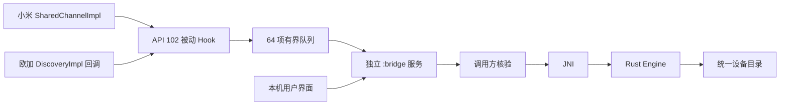

# 架构与当前边界

2026-11-08 更新：下文保留早期诊断架构记录。当前已有独立品牌适配器、LAN Noise v2、双端确认、session_id 路由和真实 Android 电池 RPC，APK 已有网络权限。小米设备资料业务已实现转换代码；融合中心 UI 发现与其他业务未验收。以 [当前公共契约](../adapters/hyperos4/shared-contract.md) 与 [能力账本](../adapters/hyperos4/capability-matrix.md) 覆盖下文“尚未接入/无网络”的旧状态。

## 目标：双向设备代理

用户明确要求中间层代表真实异品牌设备参与通信：小米侧原生接口看到一部兼容手机，实际信息来自一加 Ace 6；欧加侧看到兼容平板，实际信息来自 Xiaomi Pad 8 Pro。中间层同时负责设备映射、连接接管、业务转换、真实执行结果回传。原生发现观察只保留为诊断能力。

此图是目标，不代表已完成链路。优先在两端都安装 LSP 的前提下接管原生 SDK/业务边界；若某项功能仍必须经过厂商底层协议，则继续补齐对应真实协议。设备角色和协议外观可适配，显示信息保留真实来源；桥接设备别名不冒用其他真实设备的账号或私钥。配对、接收确认与撤销仍属于真实会话。

新增 Rust `gateway` 已实现身份映射、真实档案保留、能力交集、别名到会话/真实端点的路由以及断线撤回；尚未连接 Android 原生对象注入、实际网络认证或业务处理器。`ConfirmedLink` 是未来认证层传入的可信上下文，不是密码学认证实现，未开放 JSON 入口。详见 [设备代理](device-gateway.md)。

## 已安装版本：观察与诊断通路

Java 负责 API 102 生命周期、反射复制、Android Binder 与控制界面；统一模型、转换、会话和业务判断位于 Rust。没有旧 Xposed API 或虚构的 Rust libxposed 绑定。

两种来源代表适配器，并非已经建立跨设备链路。桥接服务与 LSP 模块同 APK、独立进程。当前没有网络监听、INTERNET 权限或 KSU 依赖。

## 已实现的业务

`local_device_catalog`：系统自行发现设备 → 原厂回调正常完成 → 复制已核实标量 → 异步 Binder → Rust 核验会话、映射事件、维护目录 → 模块 UI 查询。found/changed 更新，lost 删除。observed 仅表示收到回调，不是配对或连接。

厂商类型保留为 vendor_device_type，能力位保留为 vendor_capabilities。只有本机目录声明 available；native_pairing/native_file_transfer 均为 unsupported。未知位不推断成文件、投屏或剪贴板能力，同账号等未定义输入字段被拒绝。

## 安全与生命周期

- 每次 Binder 调用取真实 UID/PID，核验唯一包归属、版本和当前 signer；多包共享 UID 或样本变化直接拒绝。信任边界是厂商进程，无法区分同进程其他已获执行权的代码。
- 厂商进程只能 open/observe，不能读目录、改开关或调用业务；后者仅限模块 UID。
- 用户开启后签发 256 位随机 token，绑定 UID/PID/来源，5 分钟过期，递增序号防重放。它是本机采集租约，**不是设备配对凭据**。
- 同一进程重开租约使原租约及记录失效；最多 16 会话、256 记录、8192 字节命令。
- 观察记录 120 秒失效，每次操作清理；失效不等于原生离线。没有刷新回调时需重新触发系统发现。
- 队列满或等待超过 5 秒时丢弃；不把厂商对象/Chain 跨线程传递。Binder 在工作线程执行。目录是尽力观察，不保证完整性。
- 停止清空全部记录/会话，服务重启默认停止，无持久化授权和自动确认。设备名称只留在内存，ID 每会话加盐；没有账号、文件内容采集。

Binder 协议为本项目私有 `IBridge.v1`，只有一个有界 JSON 方法，校验 descriptor 和完整请求边界；不复用厂商 transaction 编号。使用直接 Binder 实现避免 Windows AIDL 工具在中文路径上的 depfile 编码问题。

## 剩余阻碍

1. 双端 API 102 装载、Application.attach 身份核验和厂商进程绑定已实测；发现回调到 Rust 的通路仍未证实，本轮目录为空，需先补齐诊断或原厂可发现对照设备，避免重复盲测。
2. Lyra native 帧/账户信任、SCP 的 NDSF/OOBKEY、UKEY2 附加数据及 nonce/重连未形成可互操作实现。
3. 原生设备投射、能力协商和双向业务路由未实现；文件仍需核对 Continuity/MiExpress 与 OAF/ICDF 全链。
4. 配对与收件必须保留实际用户确认、拒绝、超时和撤销，不能通过返回成功替代认证。

transport 当前只是离线证据工具，不参与 APK 网络业务。
